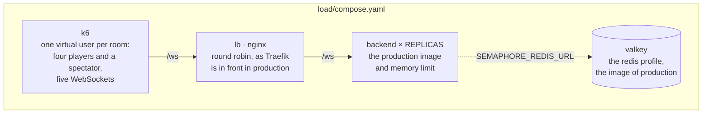
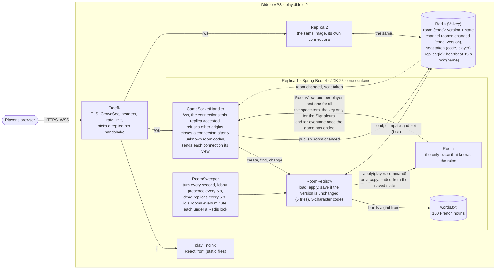
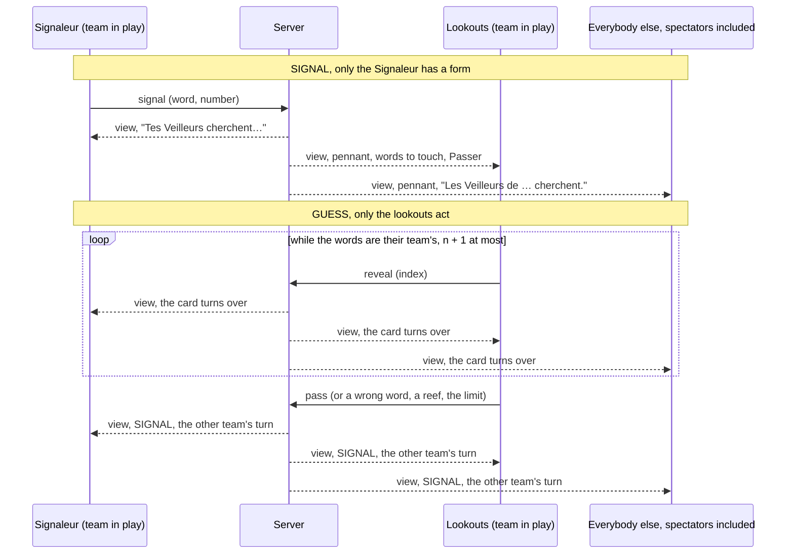
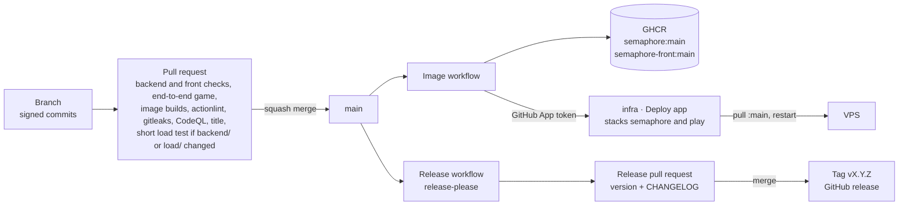

# semaphore
Real-time multiplayer word game for two teams: one player signals a word and a number, the others find the right words on the grid. Spring Boot, React, WebSockets.

**Sémaphore** is a word game for two teams on a 6×4 grid. Each team has a Signaleur who sends a word and a number, and lookouts who must find the matching words without hitting a reef. The rules and the visual direction are in [ADR 0001](docs/adr/0001-name-rules-and-visual-direction.md).

You can create a room, invite friends with a link, pick a team, start the game and play it to the end: the Signaleur sends a signal, the lookouts touch words or pass, and the winner is announced with the whole key. The backend enforces every rule over a WebSocket; the front shows what it is told ([ADR 0004](docs/adr/0004-a-react-front-on-the-design-system.md)) and lets each player do only what their role allows in the phase of the game ([ADR 0005](docs/adr/0005-the-table-by-role-and-phase.md)). The lobby and the table show who is online, a lobby keeps the seat of a player who drops for a few seconds, and the table says who the game is waiting for and counts the seconds before the turn passes: a Signaleur away for 60 seconds loses the turn, and a team without its Signaleur for 5 minutes loses the game. A friend who arrives late can watch the game in progress from the invitation link, read only and without a seat, as one of 20 spectators who see what a lookout sees (the key only once the game has ended) and are counted for the players ([ADR 0006](docs/adr/0006-presence-and-disconnections.md)). A connection that asks for 5 room codes that do not exist, by joining, watching or rejoining, is closed by the server, so guessing codes costs a new connection every five tries.

## Run the backend

```bash
cd backend
./gradlew bootRun   # needs a JDK 25; http://localhost:8080/actuator/health
./gradlew check     # formatting and tests, the Redis ones in a container: needs a Docker daemon
```

The WebSocket is `/ws`; for local development set `SEMAPHORE_ALLOWED_ORIGINS=http://localhost:5173`. The choices behind it are in [ADR 0002](docs/adr/0002-spring-boot-gradle-and-a-plain-websocket.md). The rooms, the states and the messages are in [ADR 0003](docs/adr/0003-rooms-the-state-machine-and-the-protocol.md).

### Rooms in Redis

By default the rooms live in the memory of the process, which is what development, the unit tests and the end-to-end test use. Set `SEMAPHORE_REDIS_URL` (`redis://:password@host:6379`, a Valkey 9 in production; empty means none) to keep them in Redis instead, shared by as many replicas as you start ([ADR 0008](docs/adr/0008-rooms-in-redis-shared-by-replicas.md)). The backend starts before Redis does and finds it later, and its health does not include Redis. It logs one line at startup, `rooms: memory` or `rooms: redis host:port` (never the password), so a replica started without the URL does not pass for one that has it. To try two replicas on this machine:

```bash
docker run -d --rm --name semaphore-redis -p 6379:6379 valkey/valkey:9.1.2-alpine valkey-server --requirepass secret --maxmemory 64mb --maxmemory-policy noeviction
```

```bash
SEMAPHORE_REDIS_URL=redis://:secret@localhost:6379 SERVER_PORT=8080 ./gradlew bootRun
```

```bash
SEMAPHORE_REDIS_URL=redis://:secret@localhost:6379 SERVER_PORT=8081 ./gradlew bootRun   # in another terminal
```

Without a JDK 25, run Gradle in a container. The Redis and Postgres tests start their own Valkey and Postgres with Testcontainers, so the container gets the Docker socket and reaches the published ports through the host (on Linux, add `--add-host host.docker.internal:host-gateway`):

```bash
docker run --rm -v "$PWD/backend:/app" -v semaphore-gradle:/gradle-home -e GRADLE_USER_HOME=/gradle-home -v /var/run/docker.sock:/var/run/docker.sock -e TESTCONTAINERS_HOST_OVERRIDE=host.docker.internal -w /app gradle:9.8.2-jdk25-alpine ./gradlew check
```

### Database

There is no database by default. Set `SPRING_DATASOURCE_URL` (`jdbc:postgresql://host:5432/semaphore`, empty means none), `SPRING_DATASOURCE_USERNAME` and `SPRING_DATASOURCE_PASSWORD` to give the backend a Postgres 17: it migrates the schema when it starts with Flyway (`backend/src/main/resources/db/migration`) and keeps a `JdbcClient` for the code that needs it ([ADR 0013](docs/adr/0013-postgres-with-flyway-and-a-plain-jdbc-client.md)). In production the password is a secret file read with `SPRING_CONFIG_IMPORT=configtree:/run/secrets/`, as the Redis address is. A migration only adds, for one release, because the previous version keeps running on the new schema during a rolling deploy. The health of the backend does not include the database.

```bash
docker run -d --rm --name semaphore-postgres -p 5432:5432 -e POSTGRES_PASSWORD=secret -e POSTGRES_DB=semaphore postgres:17-alpine
```

```bash
SPRING_DATASOURCE_URL=jdbc:postgresql://localhost:5432/semaphore SPRING_DATASOURCE_USERNAME=postgres SPRING_DATASOURCE_PASSWORD=secret ./gradlew bootRun
```

## Run the front

```bash
cd front
npm ci
npm run dev     # http://localhost:5173, /ws goes to a backend on :8080
npm run check   # lint, types, tests, production build
```

Start the backend with `SEMAPHORE_ALLOWED_ORIGINS=http://localhost:5173` (a port taken by another server makes Vite refuse to start with `--strictPort`, and the origin must match the port actually used).

## Run the end-to-end test

One game, four players in four browser contexts, against the real backend and the built front ([ADR 0007](docs/adr/0007-an-end-to-end-test-of-a-whole-game.md)).

```bash
(cd backend && ./gradlew bootJar)                          # needs a JDK 25, builds build/libs/semaphore.jar
(cd front && npm ci && npm run build)
cd e2e && npm ci && npx playwright install chromium
npm test    # starts the jar on :8080 and `vite preview` on :4173, then plays the game in a few seconds
```

Without a JDK 25 on the machine, build the jar and run it in containers, from the repository root, then start `npm test` in `e2e/`: outside CI Playwright reuses a backend that already listens on :8080, which must allow `http://localhost:4173` as below (the front is always started by the test).

```bash
docker run --rm -v "$PWD/backend:/app" -v semaphore-gradle:/gradle-home -e GRADLE_USER_HOME=/gradle-home -w /app gradle:9.8.2-jdk25-alpine ./gradlew bootJar
docker run -d --rm --name semaphore-e2e-backend -p 8080:8080 -e SEMAPHORE_ALLOWED_ORIGINS=http://localhost:4173 -v "$PWD/backend/build/libs/semaphore.jar:/app/semaphore.jar:ro" eclipse-temurin:25-jre-alpine java -jar /app/semaphore.jar
docker rm -f semaphore-e2e-backend   # when you are done
```

A failed run leaves a trace of the four pages: `npx playwright show-trace test-results/*/trace.zip`. In CI it is the `e2e-traces` artifact of the run.

## Run the load test

k6 plays whole games over the real protocol against a backend of its own: the host creates a room, three players join it, two teams, the game starts, a spectator watches, and the Signaleurs and lookouts play until a team has found its eight words. Everything runs in containers, so the machine needs Docker and nothing else (the backend image is built from `backend/`, with its JDK 25).

```bash
docker compose -f load/compose.yaml up --build --exit-code-from k6
docker compose -f load/compose.yaml down   # when you are done
```

The command exits with k6's status: 0 when every threshold held, 99 when one did not. The numbers are printed at the end and kept in `load/results/` (`summary.md`, `summary.json`). It never goes near `play.didelo.fr`, whose edge allows 24 connections per address where a table needs five: the script refuses a `WS_URL` on `didelo.fr`, and the backend of the compose file only accepts the origin k6 sends, which production would refuse.



| Variable | Default | What it sets |
|---|---|---|
| `PROFILE` | `short` | `short`: 50 rooms for 30 seconds, what a pull request runs. `long`: 100 rooms for 5 minutes, what the workflow runs on demand |
| `ROOMS` | by profile | rooms playing at once: each one is a virtual user, so 5 connections per room |
| `DURATION` | by profile | how long rooms start new games; a game that has started is played to its end |
| `THINK_MS` | `100` | the pause before each command, 0.5 to 1.5 times this: a player reads the table before acting |
| `P95_MS` | by profile | the threshold on the p95 of a command, 1000 ms for `short` and 1450 ms for `long` |
| `REPLICAS` | `1` | backend containers behind nginx |

For example `PROFILE=long docker compose -f load/compose.yaml up --build --exit-code-from k6`. That is one replica with its rooms in memory. Production is moving to two replicas whose rooms live in Valkey ([ADR 0008](docs/adr/0008-rooms-in-redis-shared-by-replicas.md)), and the `load` workflow plays that shape:

```bash
COMPOSE_PROFILES=redis SEMAPHORE_REDIS_URL=redis://redis:6379 REPLICAS=2 docker compose -f load/compose.yaml up --build --exit-code-from k6
```

The `redis` profile starts the Valkey image and options of production (`stacks/redis` of the infra repository, without a password: nothing but this rig reaches it), makes the replicas wait for it, and `SEMAPHORE_REDIS_URL` is what tells them to use it. nginx does what Traefik does, a replica per handshake with nothing sticky, so most tables get connections on both replicas (the round robin runs in each worker of nginx, a few tables land on one): a "no such room" is a room that one replica could not see. `REPLICAS=2` alone shows it: without `SEMAPHORE_REDIS_URL` the rooms stay in the process of each replica and the test reports it.

### Thresholds

k6 exits with 99 when one of the three is broken.

| Threshold | What it says |
|---|---|
| `protocol_errors` is 0 | counted per connection that suffered one: a refusal, an answer of the wrong kind or missing after 10 seconds, an update that never comes, a connection that dropped or was refused |
| `games_finished` is 100% | every game ended with a winner, seen by the five connections of the table |
| `command_duration` p95 under 1000 ms (`short`) or 1450 ms (`long`) | 95% of the commands were answered within that time, from the message to the answer that carries its id |

The values come from the GitHub runner (`ubuntu-latest`, 4 vCPUs), the machine the check runs on, with the shape production is moving to: k6, nginx, two replicas of the backend with their limit of 384 MiB each and a Valkey, all on that one machine, 100 ms to think. This scenario was run there several times and with several sizes, k6 reading the clock in milliseconds (a range is the lowest and the highest of the runs):

| Rooms | Duration | Runs | Games | p95 | p99 | max |
|---|---|---|---|---|---|---|
| 50 | 30 s | 7 | 450 to 550 | 12 to 99 ms | 46 to 172 ms | 164 to 367 ms |
| 100 | 30 s | 1 | 600 | 252 ms | 448 ms | 1105 ms |
| 100 | 5 min | 5 | 6417 to 8161 | 88 to 144 ms | 198 to 343 ms | 2149 to 5571 ms |
| 150 | 5 min | 1 | 7719 | 198 ms | 447 ms | 3268 ms |
| 200 | 5 min | 1 | 12663 | 130 ms | 327 ms | 2468 ms |

Every run had no error but one of the five at 100 rooms for 5 minutes, which had two: "the server is busy, try again". Both replicas logged a command to Valkey timing out after 2 seconds within the same second, and Valkey logged nothing at that time, but a stalled Valkey leaves nothing in its log either, so the runner, the JVMs or Valkey stopped and the logs do not say which. It is the answer the backend gives when the store does not answer, and the check is not required: a red run of this kind is a reason to run it again and look.

The same runs of one replica with its rooms in memory (`REPLICAS=1`, the compose file without a profile), measured along with the first batch of the runs above (50 rooms: 12, 32 and 61 ms; 100 rooms: 88, 102 and 144 ms) and in the first measurements of this test:

| Rooms | Duration | Games | p95 | p99 | max |
|---|---|---|---|---|---|
| 50 | 30 s, two runs | 552, 552 | 3, 3 ms | 50, 34 ms | 148, 196 ms |
| 100 | 5 min | 10741 | 3 ms | 21 ms | 974 ms |
| 50 | 30 s, three runs, first measurements | 551, 550, 557 | 5, 5, 2 ms | 43, 17, 12 ms | 178, 165, 224 ms |
| 100 | 30 s, first measurements | 975 | 43 ms | 154 ms | 1901 ms |
| 100 | 5 min, first measurements | 10351 | 13 ms | 61 ms | 1072 ms |
| 150 | 5 min, first measurements | 12647 | 70 ms | 170 ms | 2262 ms |
| 200 | 5 min, first measurements | 12489 | 169 ms | 291 ms | 1966 ms |

What the rooms in Valkey and the second replica cost: every command now reads and writes the room in Valkey (a compare-and-set) and the other replica hears of it through a channel, where it used to change an object in the process. The median round trip goes from 1 ms to 1 to 7 ms at 50 rooms and to 5 to 28 ms at 100 rooms for 5 minutes, the p95 from 3 ms to 12 to 99 ms at 50 rooms and to 88 to 144 ms at 100, and the games played in 5 minutes by 100 rooms fall from 10741 to 6417 to 8161 (thinking alone takes a game about 3 seconds, the pace of one replica in memory). At 200 rooms the two replicas are no slower than the single one in memory (130 ms against 169 ms): they share the work of two JVMs, or the run was on a faster runner, since runs of the same size differ more than that and no ranking of the sizes among themselves can be read in the table.

Each threshold is **ten times the worst p95 of its profile, rounded up to a multiple of 50 ms**: 99 ms gives 1000 for `short` and 144 ms gives 1450 for `long`. They were 50 and 150 with one replica in memory: the cost above is why they rose, and so is the spread, since identical runs of 50 rooms differ by a factor of eight here (12 to 99 ms) where they differed by two or three with one replica. A tighter margin would turn noise into red runs, while a command that waits for others (a lock shared by every room, a slow save) moves the p95 by far more than ten. These thresholds only catch a collapse: what proves that the rooms are shared is `protocol_errors` at 0, since most tables get connections on both replicas. On a laptop that runs other containers the same scenario can be ten times slower, which says nothing about the code: raise `P95_MS` there.

The `load` workflow plays the shape production is moving to (two replicas and a Valkey). It runs the short profile on every pull request that touches `backend/**`, `load/**` or the workflow itself, and the long one on demand (Actions, Load, Run workflow), puts the numbers in the job summary and keeps `load/results/` as the `load-results` artifact. It is not a required check: it measures a shared runner, and a slow run is a reason to look, not to block a merge.

## Architecture

The diagram is updated in the same pull request as any change it shows. It shows two replicas of the backend with their rooms in Redis ([ADR 0008](docs/adr/0008-rooms-in-redis-shared-by-replicas.md)); one replica without `SEMAPHORE_REDIS_URL` is the same picture without Redis, its rooms in the process.



### What the rooms in Redis cost

Measured on this machine with Valkey 9.1.2 in a container (a started room of four players is 2.2 KB of JSON). `StoreCostIT` prints the first three lines; the others are the image run read-only with 384 MiB, a Valkey next to it with `maxmemory 64mb`, and 25 rooms of four players held open.

| | In memory | With Redis |
|---|---|---|
| Load a room | about 0 µs | about 200 µs |
| Save a room (load, compare-and-set) | about 0 µs | about 380 µs |
| A whole command (load, apply, save) | about 1 µs | about 370 µs |
| Backend at rest | 128 MiB | 156 MiB |
| Backend with 100 connections | 163 MiB | 203 MiB |
| Valkey with those 25 rooms | | 1.3 MB |

The container stays healthy in 384 MiB and stops in under a second with its connections open. The load test ([#38](https://github.com/Didelo-lilian/semaphore/issues/38)) measures the same under load.

## The table

What a player sees and can do depends on the phase of the room, on the team in play and on their role. The screen is a function of the view the server sends to that player, so coming back after a reload needs nothing more. [ADR 0005](docs/adr/0005-the-table-by-role-and-phase.md) has the diagram of who may act in each phase; this one follows a turn.



## Tests

| Kind | Where | What it proves |
|---|---|---|
| Rules | `RoomTest` | every legal and illegal move in each state, signal validation, both ways to win, the Signaleur fixed for the grid, leaving the lobby, a lobby that keeps an absent player for 30 seconds then drops them, the start refused while someone is offline, the seat kept when leaving a game, the spectators (no key before the end in any view built for them, 20 at most, refused in a lobby, never keeping a room alive), the turn that passes after 60 seconds away (and starts the wait again on the team's next turn), at once for someone who left, the end of a game after 5 minutes without a Signaleur, nobody replacing a Signaleur, the seconds left in the view, the key never in a lookout's view, the players tied to a replica (a late close from another replica ignored, the players of a dead replica marked absent, its spectators dropped), a player who is gone refused instead of crashing the command |
| Registry, words | `RoomRegistryTest`, `WordListTest` | codes, sweep of abandoned rooms, a change replayed on a newer room after a conflict and refused as busy after 5, a refused move leaving the room as it was, a clean word list with no two words too close |
| Store | `RoomStoreContract`, run by `InMemoryRoomStoreTest` and `RedisRoomStoreIT` | what any store must do (a room comes back as saved, empty lists included, a code taken is refused, a replace or a drop only at the version that was loaded), and for Valkey: a field this version does not know is read, the 24-hour life renewed by each save, a write refused for memory raising "full" while the reads go on, a state it cannot read answered as busy |
| Replicas | `ReplicasTest` | two handlers over one store with a channel that can lose messages: a player on each, the id kept on the sender's answer only, the key and the tokens never on the channel, a rejoin on the other replica closing the old connection, a lost `seatTaken` or message repaired by the check of versions, a replica judged dead while its connections are fine set right, a close that could not be written tried again unless the player is back, two rejoins of one player on two replicas leaving the one the room holds, a seat made while the room is being read, a connection that closes while its player is marked back, a room that cannot be read not stopping the sweep of the others, a player swept away while connected losing the connection, a replica stopped without losing the room, a heartbeat that runs out, each sweep running on one replica per tick (checked against the store) |
| Redis | `RedisClusterIT`, `RedisReplicasIT`, `RedisLateStartIT`, `StoreCostIT` | against a real Valkey: the heartbeat that expires, a lock taken by one replica, a channel that subscribes again after a break; two backends started in one test with real WebSocket clients (see each other, hidden cards, rejoin elsewhere, a stopped replica, players marked absent when its heartbeat runs out, a lost message caught up, a write refused for memory); the heartbeat and the locks still taken when Redis is full; a backend started before Redis, healthy and refusing cleanly until Redis arrives; the cost of a command |
| Database | `NoDatabaseTest`, `DatabaseIT`, `DatabaseDownIT` | without a URL no `DataSource` and no Flyway (every other test of the backend runs that way), against a real Postgres the migrations ran and a query works, and the health check stays up, with no database component, once Postgres is stopped |
| WebSocket | `WebSocketIT` | the application on a random port, driven by the JDK's WebSocket client: create, join, leaving the lobby on purpose, a dropped lobby player shown offline and coming back with their seat, rejoin with a token, a new connection replacing the old, errors and missing fields, the id of a message echoed on its answer and absent from what goes to the others, a started game, a turn that passes at once when the Signaleur in play leaves, a spectator who watches a game, is counted, never receives the key before the end over a real game played to its last reef, has every command refused, the 21st refused, a connection closed at its 5th unknown room code (join, watch and rejoin counted together, the refusal of the 5th never sent, a success not resetting the count, a valid rejoin never blocked, a seat whose room was swept costing one miss), whatever a closed connection keeps sending ignored, refused origin |
| Handler | `GameSocketHandlerTest` | a broken connection does not stop the others, a room that could not be entered is not kept, one room per connection, the sweep telling the lobby that an absent player is gone, the sweep passing the turn of a game that waits for an absent Signaleur, a `leave` without a seat refused, the count of unknown room codes going with the connection, a message that arrives after the close ignored, a store that is unavailable answered with an error, and a rejoin answered with a close of both connections that makes the front try again |
| Protocol | `protocol.test.ts` | the Zod schemas read messages captured from the real backend (lobby join and answered update with their id, Signaleur's view, lookout's view without one, a view with the seconds left before the turn passes, a spectator's view with no player of its own, error with its id) and refuse anything else |
| Client | `client.test.ts`, `reasons.test.ts` | the connection with a fake WebSocket: queued messages, seat remembered, late views dropped, rejoin after a reload, `leave` sent before closing, retries with growing delays, no fight between two tabs, each command settled by the answer that carries its id (two in flight, an update caused by someone else or an answer without id settles nothing), a `watch` that remembers no seat and a lost connection that sends a spectator back to the link, a connection closed for too many unknown rooms that is not reopened without a seat, whose reason rejects the command in flight and that a stored seat rejoins as after any lost connection, the French wording of the reasons |
| Screens | `app.test.tsx`, `screens.test.tsx` | create a room and land in its lobby, invitation link, refusal shown where it was asked, room link without a seat, seat back after a reload, team choice, start rules, the key only for Signaleurs, the table for each role and phase (signal form, words to touch, waiting lines, winner and whole key), presence (online count, offline players dimmed, the start held while someone is away, the line naming the Signaleur or the lookouts the game waits for, the countdown that restarts with each view), the invitation page that offers to watch, the table read only for a spectator (no form, no word to touch, no pass, leaving at once, the whole key after the end, the count shown to the players too), the French reason shown when the server closes the connection for too many unknown rooms, a whole game played as a lookout through the router and a fake socket |
| Motion | `motion.test.tsx`, `motion.test.ts` | a card turns when a view reveals it and not when it is already revealed on the first render, a turn that another view does not cut, a player who comes in, goes out (kept as a hidden row until its fade ends) or comes back before it ends, absence and return that mark nothing, nothing marked or kept under reduced motion, and the stylesheet: durations and curves equal to the theme of the design system, every animation switched off under `prefers-reduced-motion` |
| End to end | `e2e/full-game.spec.ts` | the real front and the real backend together, in four browser contexts: Alice creates a room and invites the others with its link, everybody picks a team, the Signaleurs are the first of their team to have arrived, only they see the key, the server refuses a signal that is a word of the grid and the front says why, the Signaleurs signal and the lookouts touch their words and pass until a team has found all of its words, the winner is announced to the four players and each goes back home |
| Load | `load/game.js` | the same game played over the real protocol by many tables at once against the production image behind nginx: every game ends with a winner in all five views, no refusal, no answer missing, and the round trip of a command (from the message to the answer that carries its id) stays under the threshold; the time for a signal to reach the lookouts' view is measured too |

`./gradlew check` runs the backend ones with the formatting check (the Redis and database ones start a Valkey and a Postgres with Testcontainers, so they need Docker), `npm run check` the front ones with lint, types and the build. The pull request runs both (JDK 25, Node 24), plays the end-to-end game, builds the two images, lints the workflows, scans for secrets and runs CodeQL. When it touches `backend/` or `load/` it also plays the short load profile, which is not a required check.

## Delivery



The release workflow needs the `didelo-release` GitHub App installed on this repository, with its `RELEASE_APP_ID` variable and `RELEASE_APP_PRIVATE_KEY` secret ([#5](https://github.com/Didelo-lilian/semaphore/issues/5)).

