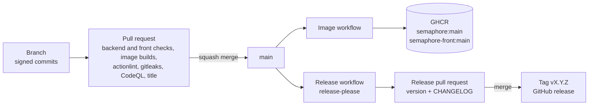

# semaphore
Real-time multiplayer word game for two teams: one player signals a word and a number, the others find the right words on the grid. Spring Boot, React, WebSockets.

**Sémaphore** is a word game for two teams on a 6×4 grid. Each team has a Signaleur who sends a word and a number, and lookouts who must find the matching words without hitting a reef. The rules and the visual direction are in [ADR 0001](docs/adr/0001-name-rules-and-visual-direction.md).

First milestone, "Game v0.1": you can create a room, invite friends with a link, pick a team and start the game, and everyone sees the grid. Playing the turns comes next. The backend enforces every rule over a WebSocket; the front shows what it is told ([ADR 0004](docs/adr/0004-a-react-front-on-the-design-system.md)).

## Run the backend

```bash
cd backend
./gradlew bootRun   # needs a JDK 25; http://localhost:8080/actuator/health
./gradlew check     # formatting and tests
```

The WebSocket is `/ws`; for local development set `SEMAPHORE_ALLOWED_ORIGINS=http://localhost:5173`. The choices behind it are in [ADR 0002](docs/adr/0002-spring-boot-gradle-and-a-plain-websocket.md). The rooms, the states and the messages are in [ADR 0003](docs/adr/0003-rooms-the-state-machine-and-the-protocol.md).

## Run the front

```bash
cd front
npm ci
npm run dev     # http://localhost:5173, /ws goes to a backend on :8080
npm run check   # lint, types, tests, production build
```

Start the backend with `SEMAPHORE_ALLOWED_ORIGINS=http://localhost:5173` (a port taken by another server makes Vite refuse to start with `--strictPort`, and the origin must match the port actually used).

## Architecture

The diagram is updated in the same pull request as any change it shows.


## Tests

| Kind | Where | What it proves |
|---|---|---|
| Rules | `RoomTest` | every legal and illegal move in each state, signal validation, both ways to win, the Signaleur fixed for the grid, leaving the lobby, the key never in a lookout's view |
| Registry, words | `RoomRegistryTest`, `WordListTest` | codes, sweep of abandoned rooms, a clean word list with no two words too close |
| WebSocket | `WebSocketIT` | the application on a random port, driven by the JDK's WebSocket client: create, join, leaving the lobby, rejoin with a token, a new connection replacing the old, errors and missing fields, a started game, refused origin |
| Handler | `GameSocketHandlerTest` | a broken connection does not stop the others, a room that could not be entered is not kept, one room per connection |
| Protocol | `protocol.test.ts` | the Zod schemas read messages captured from the real backend (lobby, Signaleur's view, lookout's view, error) and refuse anything else |
| Client | `client.test.ts` | the connection with a fake WebSocket: queued messages, seat remembered, late views dropped, rejoin after a reload, retries with growing delays, no fight between two tabs, commands settled by the server's answer |
| Screens | `app.test.tsx`, `screens.test.tsx` | create a room and land in its lobby, invitation link, refusal shown where it was asked, room link without a seat, seat back after a reload, team choice, start rules, the key only for Signaleurs |

`./gradlew check` runs the backend ones with the formatting check, `npm run check` the front ones with lint, types and the build. The pull request runs both (JDK 25, Node 24), builds the two images, lints the workflows, scans for secrets and runs CodeQL.

## Delivery



The release workflow needs the `didelo-release` GitHub App installed on this repository, with its `RELEASE_APP_ID` variable and `RELEASE_APP_PRIVATE_KEY` secret ([#5](https://github.com/Didelo-lilian/semaphore/issues/5)).

