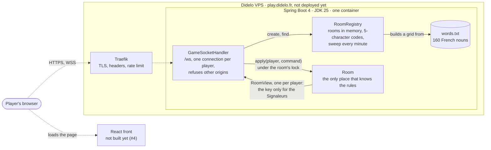
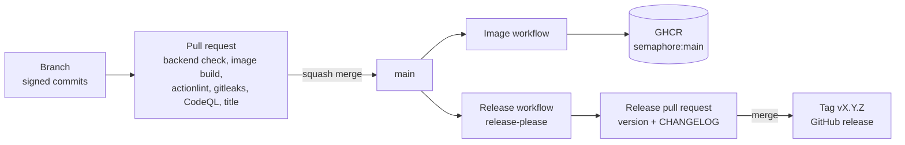

# semaphore
Real-time multiplayer word game for two teams: one player signals a word and a number, the others find the right words on the grid. Spring Boot, React, WebSockets.

**Sémaphore** is a word game for two teams on a 6×4 grid. Each team has a Signaleur who sends a word and a number, and lookouts who must find the matching words without hitting a reef. The rules and the visual direction are in [ADR 0001](docs/adr/0001-name-rules-and-visual-direction.md).

Not playable yet: this is the first milestone, "Game v0.1". The backend now holds rooms and enforces every rule over a WebSocket; the screens come next.

## Run the backend

```bash
cd backend
./gradlew bootRun   # needs a JDK 25; http://localhost:8080/actuator/health
./gradlew check     # formatting and tests
```

The WebSocket is `/ws`; for local development set `SEMAPHORE_ALLOWED_ORIGINS=http://localhost:5173`. The choices behind it are in [ADR 0002](docs/adr/0002-spring-boot-gradle-and-a-plain-websocket.md). The rooms, the states and the messages are in [ADR 0003](docs/adr/0003-rooms-the-state-machine-and-the-protocol.md).

## Architecture

What exists today is solid; the dashed parts are the next steps of the milestone. The diagram is updated in the same pull request as any change it shows.



## Tests

| Kind | Where | What it proves |
|---|---|---|
| Rules | `RoomTest` | every legal and illegal move in each state, signal validation, both ways to win, the Signaleur rotation, the key never in a lookout's view |
| Registry, words | `RoomRegistryTest`, `WordListTest` | codes, sweep of abandoned rooms, a clean word list with no two words too close |
| WebSocket | `WebSocketIT` | the application on a random port, driven by the JDK's WebSocket client: create, join, rejoin with a token, errors, a started game, refused origin |

`./gradlew check` runs them with the formatting check. The pull request runs it on JDK 25, builds the image, lints the workflows, scans for secrets and runs CodeQL.

## Delivery



The release workflow needs the `didelo-release` GitHub App installed on this repository, with its `RELEASE_APP_ID` variable and `RELEASE_APP_PRIVATE_KEY` secret ([#5](https://github.com/Didelo-lilian/semaphore/issues/5)).

