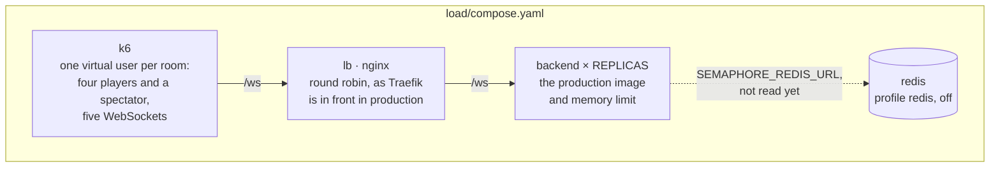
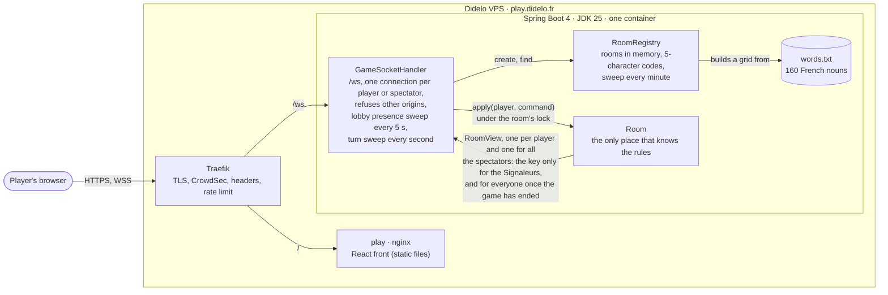
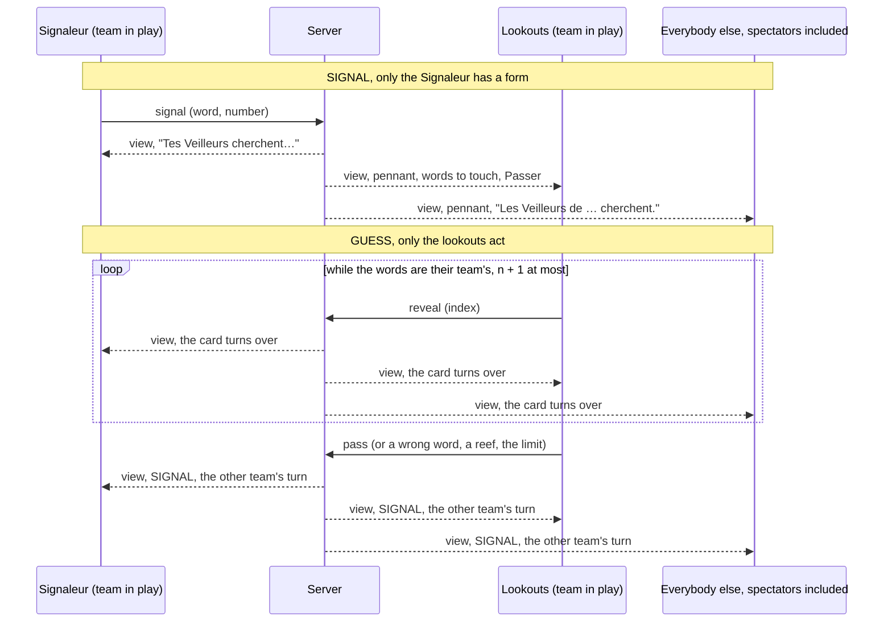
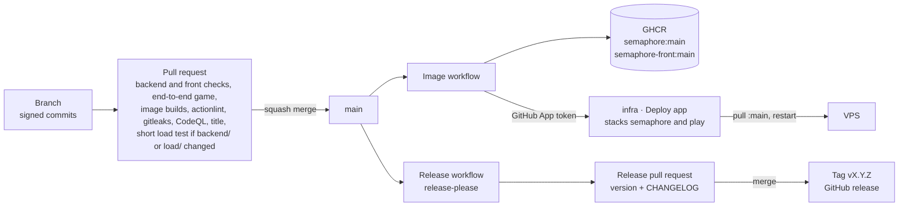

# semaphore
Real-time multiplayer word game for two teams: one player signals a word and a number, the others find the right words on the grid. Spring Boot, React, WebSockets.

**Sémaphore** is a word game for two teams on a 6×4 grid. Each team has a Signaleur who sends a word and a number, and lookouts who must find the matching words without hitting a reef. The rules and the visual direction are in [ADR 0001](docs/adr/0001-name-rules-and-visual-direction.md).

You can create a room, invite friends with a link, pick a team, start the game and play it to the end: the Signaleur sends a signal, the lookouts touch words or pass, and the winner is announced with the whole key. The backend enforces every rule over a WebSocket; the front shows what it is told ([ADR 0004](docs/adr/0004-a-react-front-on-the-design-system.md)) and lets each player do only what their role allows in the phase of the game ([ADR 0005](docs/adr/0005-the-table-by-role-and-phase.md)). The lobby and the table show who is online, a lobby keeps the seat of a player who drops for a few seconds, and the table says who the game is waiting for and counts the seconds before the turn passes: a Signaleur away for 60 seconds loses the turn, and a team without its Signaleur for 5 minutes loses the game. A friend who arrives late can watch the game in progress from the invitation link, read only and without a seat, as one of 20 spectators who see what a lookout sees (the key only once the game has ended) and are counted for the players ([ADR 0006](docs/adr/0006-presence-and-disconnections.md)).

## Run the backend

```bash
cd backend
./gradlew bootRun   # needs a JDK 25; http://localhost:8080/actuator/health
./gradlew check     # formatting and tests
```

The WebSocket is `/ws`; for local development set `SEMAPHORE_ALLOWED_ORIGINS=http://localhost:5173`. The choices behind it are in [ADR 0002](docs/adr/0002-spring-boot-gradle-and-a-plain-websocket.md). The rooms, the states and the messages are in [ADR 0003](docs/adr/0003-rooms-the-state-machine-and-the-protocol.md).

## Run the front

```bash
cd front
npm ci
npm run dev     # http://localhost:5173, /ws goes to a backend on :8080
npm run check   # lint, types, tests, production build
```

Start the backend with `SEMAPHORE_ALLOWED_ORIGINS=http://localhost:5173` (a port taken by another server makes Vite refuse to start with `--strictPort`, and the origin must match the port actually used).

## Run the end-to-end test

One game, four players in four browser contexts, against the real backend and the built front ([ADR 0007](docs/adr/0007-an-end-to-end-test-of-a-whole-game.md)).

```bash
(cd backend && ./gradlew bootJar)                          # needs a JDK 25, builds build/libs/semaphore.jar
(cd front && npm ci && npm run build)
cd e2e && npm ci && npx playwright install chromium
npm test    # starts the jar on :8080 and `vite preview` on :4173, then plays the game in a few seconds
```

Without a JDK 25 on the machine, build the jar and run it in containers, from the repository root, then start `npm test` in `e2e/`: outside CI Playwright reuses a backend that already listens on :8080, which must allow `http://localhost:4173` as below (the front is always started by the test).

```bash
docker run --rm -v "$PWD/backend:/app" -v semaphore-gradle:/gradle-home -e GRADLE_USER_HOME=/gradle-home -w /app gradle:9.8.2-jdk25-alpine ./gradlew bootJar
docker run -d --rm --name semaphore-e2e-backend -p 8080:8080 -e SEMAPHORE_ALLOWED_ORIGINS=http://localhost:4173 -v "$PWD/backend/build/libs/semaphore.jar:/app/semaphore.jar:ro" eclipse-temurin:25-jre-alpine java -jar /app/semaphore.jar
docker rm -f semaphore-e2e-backend   # when you are done
```

A failed run leaves a trace of the four pages: `npx playwright show-trace test-results/*/trace.zip`. In CI it is the `e2e-traces` artifact of the run.

## Run the load test

k6 plays whole games over the real protocol against a backend of its own: the host creates a room, three players join it, two teams, the game starts, a spectator watches, and the Signaleurs and lookouts play until a team has found its eight words. Everything runs in containers, so the machine needs Docker and nothing else (the backend image is built from `backend/`, with its JDK 25).

```bash
docker compose -f load/compose.yaml up --build --abort-on-container-exit --exit-code-from k6
docker compose -f load/compose.yaml down   # when you are done
```

The command exits with k6's status: 0 when every threshold held, 99 when one did not. The numbers are printed at the end and kept in `load/results/` (`summary.md`, `summary.json`). It never goes near `play.didelo.fr`, whose edge allows 24 connections per address where a table needs five: the script refuses a `WS_URL` on `didelo.fr`, and the backend of the compose file only accepts the origin k6 sends, which production would refuse.



| Variable | Default | What it sets |
|---|---|---|
| `PROFILE` | `short` | `short`: 10 rooms for 30 seconds, what a pull request runs. `long`: 60 rooms for 5 minutes, what the workflow runs on demand |
| `ROOMS` | by profile | rooms playing at once: each one is a virtual user, so 5 connections per room |
| `DURATION` | by profile | how long rooms start new games; a game that has started is played to its end |
| `THINK_MS` | `100` | the pause before each command, 0.5 to 1.5 times this: a player reads the table before acting |
| `REPLICAS` | `1` | backend containers behind nginx |

For example `PROFILE=long REPLICAS=2 docker compose -f load/compose.yaml up --build --abort-on-container-exit --exit-code-from k6`. Several replicas only work once the rooms are shared ([ADR 0008](docs/adr/0008-rooms-in-redis-shared-by-replicas.md)): with them in memory a room lives in one replica, and the five connections of a table spread over two of them get "no such room", which the test reports as protocol errors. nginx does what Traefik does in production, a replica per handshake with nothing sticky. The `redis` profile is there for that day and is off: `COMPOSE_PROFILES=redis SEMAPHORE_REDIS_URL=redis://redis:6379 REPLICAS=2` starts a Redis, makes the replicas wait for it and hands them its address, which the backend does not read yet.

### Thresholds

Three, and k6 exits with 99 when one is broken: no protocol error (a refusal, an answer that does not come, a connection that drops, the wrong kind of answer), every game ends with a winner in the five views, and 95% of the command round trips under 1000 ms (provisional, being measured on the runner).


The `load` workflow runs the short profile on every pull request that touches `backend/**` or `load/**`, and the long one on demand (Actions, Load, Run workflow), puts the numbers in the job summary and keeps `load/results/` as the `load-results` artifact. It is not a required check: it measures a shared runner, and a slow run is a reason to look, not to block a merge.

## Architecture

The diagram is updated in the same pull request as any change it shows. It shows one backend with its rooms in memory, as it runs today; the rooms move to Redis, shared by two replicas, in [ADR 0008](docs/adr/0008-rooms-in-redis-shared-by-replicas.md).



## The table

What a player sees and can do depends on the phase of the room, on the team in play and on their role. The screen is a function of the view the server sends to that player, so coming back after a reload needs nothing more. [ADR 0005](docs/adr/0005-the-table-by-role-and-phase.md) has the diagram of who may act in each phase; this one follows a turn.



## Tests

| Kind | Where | What it proves |
|---|---|---|
| Rules | `RoomTest` | every legal and illegal move in each state, signal validation, both ways to win, the Signaleur fixed for the grid, leaving the lobby, a lobby that keeps an absent player for 30 seconds then drops them, the start refused while someone is offline, the seat kept when leaving a game, the spectators (no key before the end in any view built for them, 20 at most, refused in a lobby, never keeping a room alive), the turn that passes after 60 seconds away (and starts the wait again on the team's next turn), at once for someone who left, the end of a game after 5 minutes without a Signaleur, nobody replacing a Signaleur, the seconds left in the view, the key never in a lookout's view |
| Registry, words | `RoomRegistryTest`, `WordListTest` | codes, sweep of abandoned rooms, a clean word list with no two words too close |
| WebSocket | `WebSocketIT` | the application on a random port, driven by the JDK's WebSocket client: create, join, leaving the lobby on purpose, a dropped lobby player shown offline and coming back with their seat, rejoin with a token, a new connection replacing the old, errors and missing fields, the id of a message echoed on its answer and absent from what goes to the others, a started game, a turn that passes at once when the Signaleur in play leaves, a spectator who watches a game, is counted, never receives the key before the end over a real game played to its last reef, has every command refused, the 21st refused, refused origin |
| Handler | `GameSocketHandlerTest` | a broken connection does not stop the others, a room that could not be entered is not kept, one room per connection, the sweep telling the lobby that an absent player is gone, the sweep passing the turn of a game that waits for an absent Signaleur, a `leave` without a seat refused |
| Protocol | `protocol.test.ts` | the Zod schemas read messages captured from the real backend (lobby join and answered update with their id, Signaleur's view, lookout's view without one, a view with the seconds left before the turn passes, a spectator's view with no player of its own, error with its id) and refuse anything else |
| Client | `client.test.ts` | the connection with a fake WebSocket: queued messages, seat remembered, late views dropped, rejoin after a reload, `leave` sent before closing, retries with growing delays, no fight between two tabs, each command settled by the answer that carries its id (two in flight, an update caused by someone else or an answer without id settles nothing), a `watch` that remembers no seat and a lost connection that sends a spectator back to the link |
| Screens | `app.test.tsx`, `screens.test.tsx` | create a room and land in its lobby, invitation link, refusal shown where it was asked, room link without a seat, seat back after a reload, team choice, start rules, the key only for Signaleurs, the table for each role and phase (signal form, words to touch, waiting lines, winner and whole key), presence (online count, offline players dimmed, the start held while someone is away, the line naming the Signaleur or the lookouts the game waits for, the countdown that restarts with each view), the invitation page that offers to watch, the table read only for a spectator (no form, no word to touch, no pass, leaving at once, the whole key after the end, the count shown to the players too), a whole game played as a lookout through the router and a fake socket |
| Motion | `motion.test.tsx`, `motion.test.ts` | a card turns when a view reveals it and not when it is already revealed on the first render, a turn that another view does not cut, a player who comes in, goes out (kept as a hidden row until its fade ends) or comes back before it ends, absence and return that mark nothing, nothing marked or kept under reduced motion, and the stylesheet: durations and curves equal to the theme of the design system, every animation switched off under `prefers-reduced-motion` |
| End to end | `e2e/full-game.spec.ts` | the real front and the real backend together, in four browser contexts: Alice creates a room and invites the others with its link, everybody picks a team, the Signaleurs are the first of their team to have arrived, only they see the key, the server refuses a signal that is a word of the grid and the front says why, the Signaleurs signal and the lookouts touch their words and pass until a team has found all of its words, the winner is announced to the four players and each goes back home |
| Load | `load/game.js` | the same game played over the real protocol by many tables at once against the production image behind nginx: every game ends with a winner in all five views, no refusal, no answer missing, and the round trip of a command (from the message to the answer that carries its id) stays under the threshold; the update reaching the next player to act is measured too |

`./gradlew check` runs the backend ones with the formatting check, `npm run check` the front ones with lint, types and the build. The pull request runs both (JDK 25, Node 24), plays the end-to-end game, builds the two images, lints the workflows, scans for secrets and runs CodeQL. When it touches `backend/` or `load/` it also plays the short load profile, which is not a required check.

## Delivery



The release workflow needs the `didelo-release` GitHub App installed on this repository, with its `RELEASE_APP_ID` variable and `RELEASE_APP_PRIVATE_KEY` secret ([#5](https://github.com/Didelo-lilian/semaphore/issues/5)).

