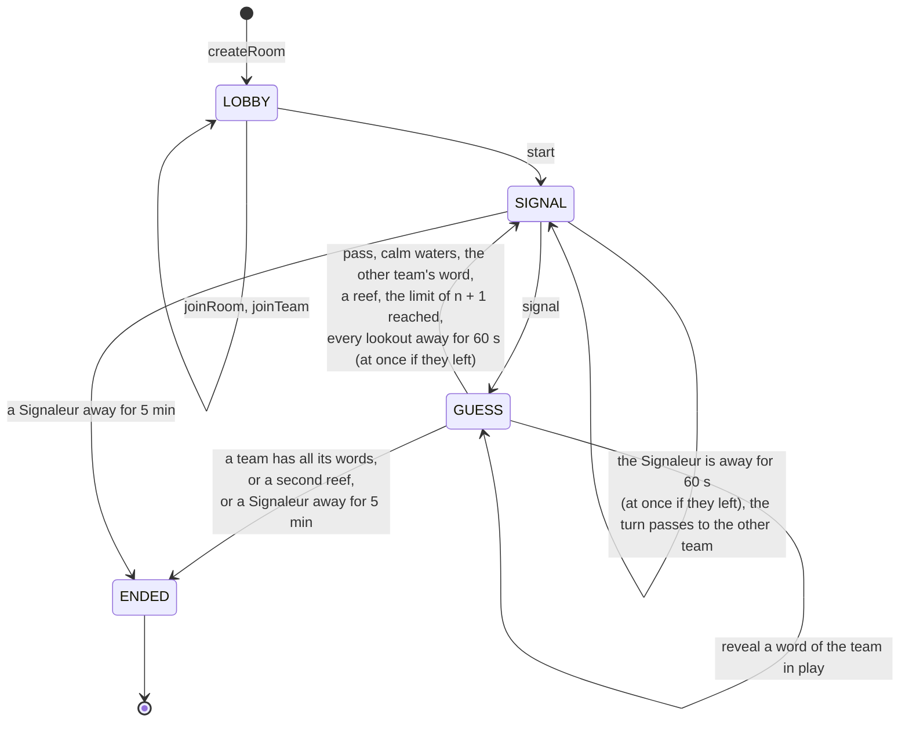
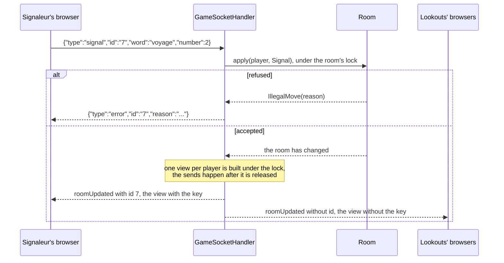

# 3. Rooms, the state machine and the protocol

Date: 2026-10-24 · Status: accepted, amended by [ADR 0006](0006-presence-and-disconnections.md)

## Context

[ADR 0001](0001-name-rules-and-visual-direction.md) wrote the rules and [ADR 0002](0002-spring-boot-gradle-and-a-plain-websocket.md) chose the wire. This one says how a game lives on the server: where the rules are, which messages exist and what a player is allowed to see.

## Decision

### One place for the rules

`Room` (package `game`) is one game, from the lobby to the end, and the only class that knows the rules. It has no dependency on Spring or on the WebSocket: the clock and the random generator are given to it, so a test plays a whole game with a fixed seed. It is not thread safe; the WebSocket handler and the sweep synchronize on the room they touch.

### Four states

| State | Legal commands | Next state |
|---|---|---|
| `LOBBY` | `JoinTeam`, `Start` | `SIGNAL` |
| `SIGNAL` | `Signal` | `GUESS` |
| `GUESS` | `Reveal`, `Pass` | `SIGNAL` (turn over) or `ENDED` |
| `ENDED` | none | |

The state decides which commands are legal at all; the room then judges who sends it and what it says (the Signaleur of the team in play, a hidden card, a signal too close to the grid). Every refusal is an `IllegalMove` with a reason, answered to the sender only.

ADR 0001 announced five states with a "round end". A turn ends at once, so there is no state between two turns, and ADR 0001 is corrected.

### Roles

- The Signaleur is not picked: it is the first member of the team in the order they joined the room, and it stays for the whole grid. It cannot rotate between turns, because a former Signaleur who becomes a lookout still knows the key and the signal would no longer matter. Rotation comes with a rematch on a new grid.
- The host is the first player of the room. Only they start the game, once everyone has a team and each team has at least two players (`semaphore.min-team-size`). A room holds twelve players. Nobody joins once the game has started.
- The starting team is drawn at random, as are the grid and the key.

### What a player sees

Each player receives their own view of the room, never the room itself. The kind of a card (Bâbord, Tribord, calm waters, reef) is in the view only if the card is revealed, if the game is over, or if the viewer is a Signaleur: both Signaleurs see the key, the lookouts of both teams do not. The kind of a hidden card is therefore never on the wire to a lookout, and a test checks it over a real WebSocket. Every view carries the room's `version`, which grows with each change, so a client that receives two views out of order keeps the one with the highest version. It also carries `turnPassesIn`, the seconds left before the turn passes when the game waits for someone who is away, or null ([ADR 0006](0006-presence-and-disconnections.md)).

### The messages

One record per legal action, JSON with a `type` field. This is what a command does, here a signal:

| Client sends | Meaning |
|---|---|
| `createRoom {name}` | open a room and join it |
| `joinRoom {code, name}` | join a room in its lobby |
| `rejoin {code, token}` | come back after a lost connection |
| `leave` | leave a room on purpose, with no answer ([ADR 0006](0006-presence-and-disconnections.md)) |
| `joinTeam {team}`, `start`, `signal {word, number}`, `reveal {index}`, `pass` | the commands above |

| Server sends | Meaning |
|---|---|
| `joined {id?, playerId, token, room}` | once, to the player who got in; the token is how they come back |
| `roomUpdated {id?, room}` | to every connected player of the room after each change, each with their view |
| `error {id?, reason}` | to the sender only; the connection stays open |

### Request ids

Every client message may carry an `id`, a string the client picks (the front counts from 1 on each page load). The server echoes it on the answer to that message and nowhere else: the `joined` that answers a `createRoom`, `joinRoom` or `rejoin`, the `roomUpdated` that goes to the sender of a command, or the `error` that refuses it. The views sent to the other players, and the one the joiner gets after their `joined`, carry none, and the key is absent from the JSON rather than `null`. A client can therefore tell the answer to its own command from an update caused by someone else, even when the two arrive in any order.

The id is the handler's business: `Room` never sees it, and `GameSocketHandler` threads it from the message to the views it builds. A message too broken to read has no id to echo, so its `error` carries none. The id is optional on the wire in both directions, because it was introduced without a flag day: the front and the backend are deployed separately and each had to cope with the other being one version behind. Both have been deployed since v0.2.0, so the front now settles a command only with the answer that carries its id (see [ADR 0004](0004-a-react-front-on-the-design-system.md)).

### Rooms

`RoomRegistry` keeps every room in memory under a five character code without `0`, `O`, `1`, `I` or `L`, since it is read aloud and typed. A room nobody is connected to for 30 minutes is dropped by a sweep that runs every minute, and so is a room nobody ever joined. A connection holds one seat: a second `createRoom`, `joinRoom` or `rejoin` on it is refused, and a room that could not be entered (a bad name) is dropped at once. A message with a missing field is as unreadable as broken JSON.

A player is the connection that holds their token. Closing the connection marks the player absent, in the lobby as in a game, and `rejoin` with the token gives the seat back; the new connection replaces the old one, which is closed, so a late close of the old one changes nothing. In the lobby the seat is kept for 30 seconds only and then the player is removed, so nobody absent blocks the start or keeps the host seat for long, and the host cannot start while someone is offline; leaving on purpose (`leave`) removes the player at once ([ADR 0006](0006-presence-and-disconnections.md)). Once the game has started the seat stays for good, and a missing Signaleur costs their team its turns, then the game ([ADR 0006](0006-presence-and-disconnections.md)): the sweep that runs every second passes the turn after 60 seconds away, at once for someone who left on purpose, and ends the game when a Signaleur has been away for 5 minutes. Nobody replaces a Signaleur: the key stays with the first of the team.

Changes happen under the room's lock but the messages go out after it is released: a slow or broken connection (its buffer overflowing throws `SessionLimitExceededException`) never holds a room or stops the others from getting their view.

### The words

`words.txt` holds 160 common French nouns written for the game. A test keeps the list clean: no duplicate and no two words that contain each other or share their first four letters, since two such words on one grid would forbid each other as signals.

## Consequences

- Messages are sent outside the room's lock, so two updates can reach a client out of order: the front keeps the view with the highest `version`.
- A Signaleur who disconnects no longer blocks the turn for good: the table says who the game is waiting for and for how long, the turn passes after 60 seconds, and the team loses after 5 minutes ([ADR 0006](0006-presence-and-disconnections.md)). The one who comes back keeps the key, since nobody replaced them.
- A restart of the server loses every room. With several replicas a room lives in one of them: sticky sessions and Redis pub/sub come with the scaling step ([ADR 0002](0002-spring-boot-gradle-and-a-plain-websocket.md)), and `Room` does not change for it.
- The records of `ClientMessage`, `ServerMessage` and `RoomView` are the contract the front validates with Zod ([#4](https://github.com/Didelo-lilian/semaphore/issues/4)).
- A command that the server never answers is not timed out: only a lost connection rejects it.
- Twelve players, two per team at least and 160 words are constants or configuration, not rules: they can move without touching the state machine.
