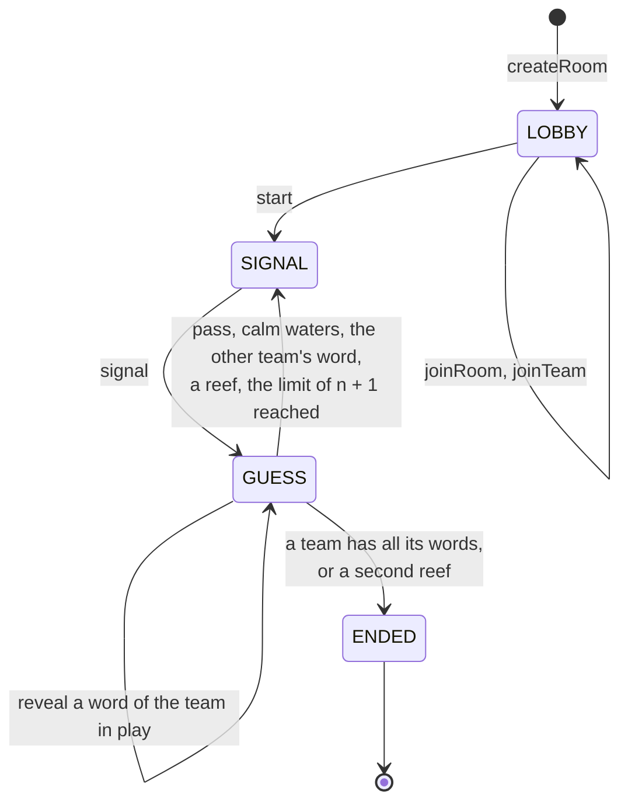
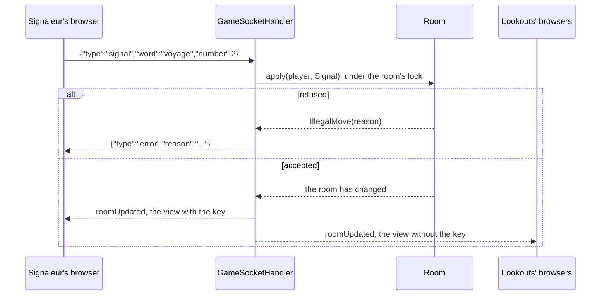

# 3. Rooms, the state machine and the protocol

Date: 2026-10-24 · Status: accepted

## Context

[ADR 0001](0001-name-rules-and-visual-direction.md) wrote the rules and [ADR 0002](0002-spring-boot-gradle-and-a-plain-websocket.md) chose the wire. This one says how a game lives on the server: where the rules are, which messages exist and what a player is allowed to see.

## Decision

### One place for the rules

`Room` (package `game`) is one game, from the lobby to the end, and the only class that knows the rules. It has no dependency on Spring or on the WebSocket: the clock and the random generator are given to it, so a test plays a whole game with a fixed seed. It is not thread safe; the WebSocket handler and the sweep synchronize on the room they touch.

### Four states

| State | Legal commands | Next state |
|---|---|---|
| `LOBBY` | `JoinTeam`, `Start` | `SIGNAL` |
| `SIGNAL` | `Signal` | `GUESS` |
| `GUESS` | `Reveal`, `Pass` | `SIGNAL` (turn over) or `ENDED` |
| `ENDED` | none | |

The state decides which commands are legal at all; the room then judges who sends it and what it says (the Signaleur of the team in play, a hidden card, a signal too close to the grid). Every refusal is an `IllegalMove` with a reason, answered to the sender only.

ADR 0001 announced five states with a "round end". A turn ends at once, so there is no state between two turns, and ADR 0001 is corrected.

### Roles

- The Signaleur is not picked. It is the member of the team at position *turns played* modulo *team size* in the order they joined the room, so each player takes the role in turn and nobody has to be chosen or to be willing.
- The host is the first player of the room. Only they start the game, once everyone has a team and each team has at least two players (`semaphore.min-team-size`). A room holds twelve players. Nobody joins once the game has started.
- The starting team is drawn at random, as are the grid and the key.

### What a player sees

Each player receives their own view of the room, never the room itself. The kind of a card (Bâbord, Tribord, calm waters, reef) is in the view only if the card is revealed, if the game is over, or if the viewer is a Signaleur: both Signaleurs see the key, the lookouts of both teams do not. The kind of a hidden card is therefore never on the wire to a lookout, and a test checks it over a real WebSocket.

### The messages

One record per legal action, JSON with a `type` field. This is what a command does, here a signal:

| Client sends | Meaning |
|---|---|
| `createRoom {name}` | open a room and join it |
| `joinRoom {code, name}` | join a room in its lobby |
| `rejoin {code, token}` | come back after a lost connection |
| `joinTeam {team}`, `start`, `signal {word, number}`, `reveal {index}`, `pass` | the commands above |

| Server sends | Meaning |
|---|---|
| `joined {playerId, token, room}` | once, to the player who got in; the token is how they come back |
| `roomUpdated {room}` | to every connected player of the room after each change, each with their view |
| `error {reason}` | to the sender only; the connection stays open |

### Rooms

`RoomRegistry` keeps every room in memory under a five character code without `0`, `O`, `1`, `I` or `L`, since it is read aloud and typed. A room nobody is connected to for 30 minutes is dropped by a sweep that runs every minute, and so is a room nobody ever joined. A player is the connection that holds their token: closing the connection only marks them disconnected, `rejoin` with the token gives the seat back.

### The words

`words.txt` holds 160 common French nouns written for the game. A test keeps the list clean: no duplicate and no two words that contain each other or share their first four letters, since two such words on one grid would forbid each other as signals.

## Consequences

- A Signaleur who disconnects blocks the turn until they come back. This is a known limit of v0.1; a timeout that passes the turn is the next step if it happens in practice.
- A restart of the server loses every room. With several replicas a room lives in one of them: sticky sessions and Redis pub/sub come with the scaling step ([ADR 0002](0002-spring-boot-gradle-and-a-plain-websocket.md)), and `Room` does not change for it.
- The records of `ClientMessage`, `ServerMessage` and `RoomView` are the contract the front validates with Zod ([#4](https://github.com/Didelo-lilian/semaphore/issues/4)).
- Twelve players, two per team at least and 160 words are constants or configuration, not rules: they can move without touching the state machine.
