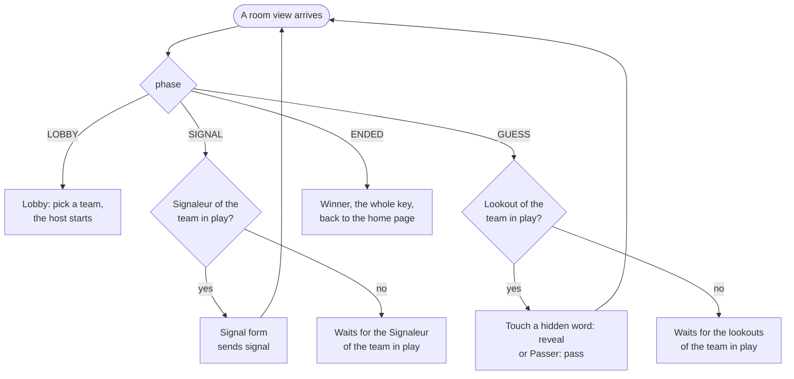
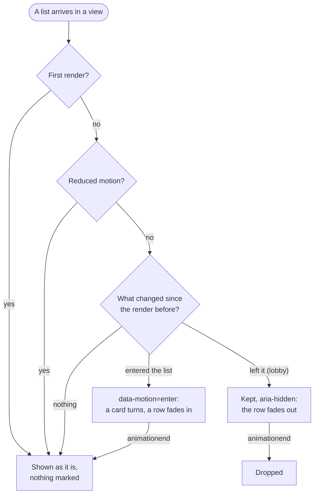

# 5. The table, by role and by phase

Date: 2026-10-24 · Status: accepted

## Context

[ADR 0003](0003-rooms-the-state-machine-and-the-protocol.md) made the server the judge of every move and [ADR 0004](0004-a-react-front-on-the-design-system.md) made the front a view of what the server says. Until now the table only showed the grid. Playing a game means that four people look at the same room and each of them must see, at once, whether it is their turn and what they can do.

## Decision

### The screen answers "who must act?" from the view alone

The room view already says everything: the `phase`, the `turn` (the team in play), who `you` are and whether you are a Signaleur. Two facts come out of it, and nothing else decides what is clickable:

- **in play**: you belong to the team whose turn it is;
- **Signaleur**: your player has `signaler` set.

| Phase | In play, Signaleur | In play, lookout | Everybody else |
|---|---|---|---|
| `SIGNAL` | the signal form | "Le Signaleur de … prépare son signal." | the same line |
| `GUESS` | "Tes Veilleurs cherchent…" | the hidden words are buttons, and "Passer" | "Les Veilleurs de … cherchent." |
| `ENDED` | the winner, the whole key, a way back home | the same | the same |

Presence changes one line of that table: when the Signaleur in play is offline during `SIGNAL`, or all the lookouts in play are during `GUESS`, the live line names who the game is waiting for instead, and a line under it counts down the seconds left before the turn passes ([ADR 0006](0006-presence-and-disconnections.md)). The count starts from the `turnPassesIn` of the view and the browser's own timer measures the time since: the browser never compares its clock with the server's, and each new view starts the count again. It is outside the live region on purpose, so a screen reader announces the line once and not every second.

Both buttons and form exist only for the player who may use them, so the server's refusals ("not your turn", "not the Signaleur") are a safety net and not something a player normally meets. The front does not replay the rules: it does not count the `n + 1` reveals, it shows how many are left (`revealsLeft`), and a signal too close to a word of the grid is judged by the server, which answers with a reason shown next to the form (`reasons.ts`). The form refuses an empty field and nothing else: what makes a valid signal (one word, letters, hyphens allowed, not too close to the grid) is the server's rule, and a copy of it in the browser would drift (a first version refused hyphenated words that the server accepts). The number is one of four buttons.

### Spectators

A spectator is "everybody else" in the table above, with nothing left to click: their view has `you` null, so they are neither in play nor a Signaleur and the screen is the same function of the view ([ADR 0006](0006-presence-and-disconnections.md)). The table says so under the presence line ("Tu regardes la partie sans y jouer."), and "Quitter" leaves at once: there is no seat to lose, so no dialog. The line that counts who is online also counts the spectators ("3 en ligne · 2 personnes regardent"), for the players as for the spectators.

### The cards and the signal

- A hidden word becomes a button that covers its card, for the lookouts in play only. A revealed word is never one. While a command waits for its answer the word buttons are `aria-disabled` and "Passer" is disabled: the commands run one after the other ([ADR 0004](0004-a-react-front-on-the-design-system.md)), a second click would only queue behind the first. A word button is not `disabled` so that the focus of a keyboard user stays on it. The buttons are freed by the answer to the command, matched by its id: a view caused by someone else does not free them.
- The signal is shown as a pennant that carries the word and the number, in the color of the team in play, with the mark of that team (triangle or circle) before the word. As everywhere in the game, the color is never alone: a shape tells the teams apart ([ADR 0001](0001-name-rules-and-visual-direction.md)). The text sits in the rectangular part of the pennant, clear of its tip: a first version clipped the whole pennant to a triangle and cut the number off.
- A card turns over when a view reveals it (see [Motion](#motion-a-change-between-two-views-never-a-value)) and the pennant is hoisted when a signal arrives. Both are CSS animations, and `prefers-reduced-motion` turns both off.

### Refusals, leaving, screen readers

- A refusal answers the view it was sent from: when a newer view arrives, `SalonPage` forgets it, so a lookout who clicked a second too late does not keep a red message for the rest of the game. A refused signal has no new view, so it stays next to the form until the Signaleur tries again.
- "Quitter" in the middle of a game asks first, because the seat cannot be taken back and a Signaleur who leaves leaves their team without turns, and finally without the game; the dialog says so to a Signaleur. After the end it leads home at once.
- The line that says who must act is a live region (`<output>`), so a screen reader announces a new turn, and it carries the signal in words ("Signal : voyage, 2."); the pennant itself is hidden from assistive technology, where it would be read as "voyage2".

### Motion: a change between two views, never a value

The screen is a function of the view, and so is its motion, with one rule: nothing is animated for what a view says, only for what it changed. A card already revealed when the page opens (arrival, `rejoin`, spectator) is a value and must not turn; the same card revealed by the next view is an event and does.

- **A hook marks, CSS plays.** `useListMotion` (`src/motion.ts`) compares a list with the one of the render before and marks what entered it (a card enters the revealed ones, a player enters the room); the stylesheet animates `data-motion`. The mark lasts until `animationend`, so a view that arrives in the middle of a turn does not cut it, and a row mounted again later (a player who picks a team) does not replay.
- **The state is never delayed.** `data-revealed`, the accessible name of the card, the buttons and the counts are final at once, so the tests and the end-to-end game do not wait for an animation. The colours of a revealed card are final in the stylesheet too: they swap at half of the turn, when the card is edge-on, through a transition with a delay, and a transition only runs when a value changes. The mark a lookout's card gains with the reveal is a new element: it starts hidden (`@starting-style`, which only applies to an element at its first render) and shows at the half like the colours.
- **A card turns in its own perspective.** One `perspective` on the whole board threw the cards at its edges out of their row. Each card turns edge-on, shows its colour and turns back, in 375 ms.
- **A row goes out as a ghost.** In a game leaving is going offline and the row stays, so only the lobby has rows that go. A player who left is kept in place, `aria-hidden`, until its fade ends, and dropped on `animationend` (the dock section that holds it stays until then); the list for assistive technology and the online count are final at once. A player who comes back in the meantime takes the row back.
- **Absence and return need no code**: `[data-online]` has a transition of its opacity, which only runs when the value changes. The countdown is in no animated element, and the animations are transforms and opacity, so none of them moves what is around the row.
- **Reduced motion.** The hook marks nothing and keeps no row (a ghost would be a row kept for an animation that never plays), and the stylesheet switches the same animations and transitions off, so the colour and the text change at once. jsdom has no `matchMedia`: the test setup answers "no motion", so every other test sees the final screen.
- **Durations and curves.** The design system has no motion tokens (1.0.0): the stylesheet takes the transitions of the MUI theme it exports (`complex` for the turn, `enteringScreen` and `leavingScreen` for a row, `easeIn`, `easeOut`, `easeInOut`), and `motion.test.ts` fails when they drift apart.
- **What it does not hide.** A connection that comes back without a reload takes the seat with `rejoin` in the same page, so the cards revealed meanwhile turn when that view lands: it is a change between two views of this page. A reload shows them revealed.

### Coming back in the middle of a turn needs no code

A reload or a lost connection ends in `rejoin`, and the answer is the whole current view of that player. The screen is a function of that view, so a player who comes back in the middle of a guess sees the signal, the cards already revealed and the right buttons, with nothing to restore.

## Consequences

- The tests follow the table: `screens.test.tsx` renders it for each role and phase (what is shown, what can be clicked, what it sends), and `app.test.tsx` plays a game as a lookout through the router and a fake socket, from the first turn to the winner and back home.
- A Signaleur who closes their tab no longer blocks the turn for good: the table says who the game is waiting for and counts the seconds down, then the turn passes ([ADR 0006](0006-presence-and-disconnections.md)). The lookouts of that team can only wait, or leave. The rooms keep living for 30 minutes after the last activity ([ADR 0003](0003-rooms-the-state-machine-and-the-protocol.md)).
- There is no rematch: the Signaleur is fixed for a grid ([ADR 0003](0003-rooms-the-state-machine-and-the-protocol.md)), so a new game is a new room. Rotation of the Signaleur comes with the rematch.
- Every merge to `main` of this repository redeploys the application, and the rooms are in memory: a game in progress does not survive it.
