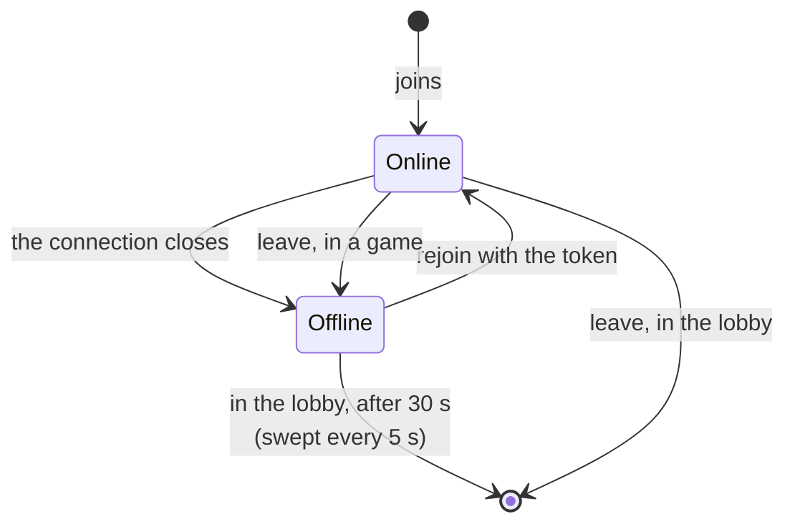
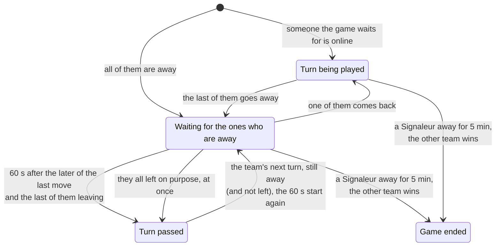
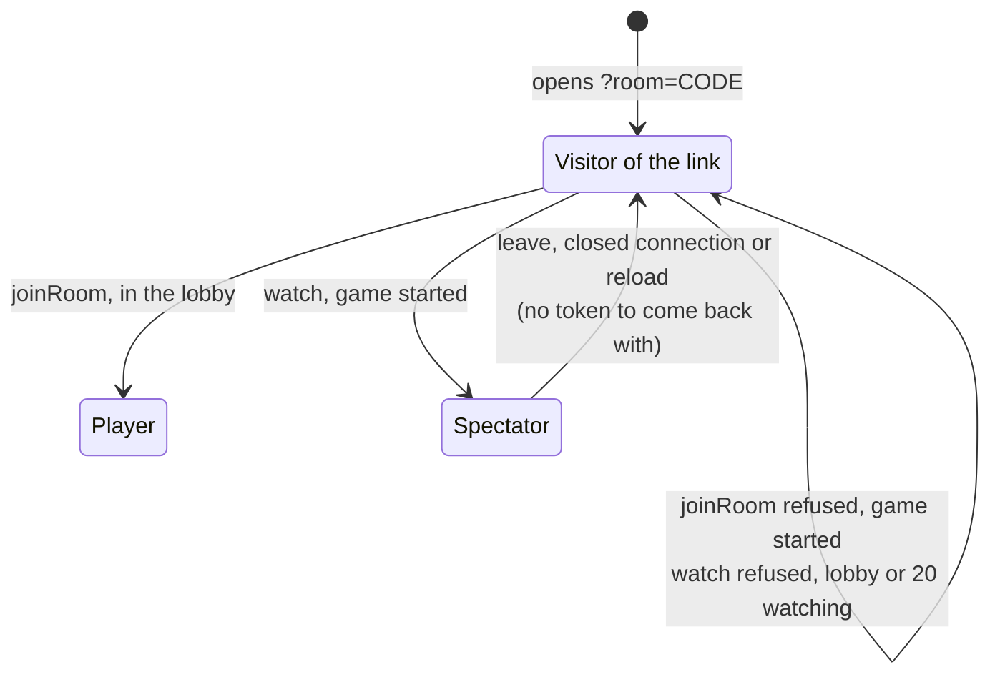

# 6. Presence and disconnections

Date: 2026-10-24 · Status: accepted (the three increments are built; the defaults of the product choices are Lilian's to change)

## Context

[ADR 0003](0003-rooms-the-state-machine-and-the-protocol.md) made the server the keeper of who is connected: every player view carries a `connected` flag, and once the game has started `rejoin` with a token gives the seat back. Three things are still wrong or missing:

- **The lobby forgets at once.** Closing the connection removes the player, so a reload, a tunnel or a phone that sleeps loses the seat, the team and sometimes the host seat.
- **Presence is hardly visible.** "hors ligne" is a suffix after a name, and nobody is told who the game is waiting for.
- **An absent player blocks.** A Signaleur who leaves stops the turn for good ([ADR 0003](0003-rooms-the-state-machine-and-the-protocol.md), [ADR 0005](0005-the-table-by-role-and-phase.md)), and a game in progress cannot be watched by someone without a seat.

Those are three decisions of different sizes, so this ADR cuts the work in increments that ship one by one, and gives a default to each product choice so that none of them blocks the work: they are Lilian's to change.

## Decision

### Three increments

| # | Increment | What it adds |
|---|---|---|
| 1 | **Who is online** (built with this ADR) | A lobby keeps an absent player for a grace period, a `leave` message for leaving on purpose, everyone's presence shown in the lobby and at the table, the start refused while someone is offline, the table saying who the game waits for |
| 2 | **A missing Signaleur or host** ([#28](https://github.com/Didelo-lilian/semaphore/issues/28)) (built) | A delay after which the turn passes, the turn passing at once for someone who left on purpose, and the end of a game that nobody can play |
| 3 | **Spectators** ([#29](https://github.com/Didelo-lilian/semaphore/issues/29)) (built) | Watch a game in progress without a seat, read only |

### Defaults of the product choices

| Choice | Default | Why |
|---|---|---|
| How long a lobby keeps an absent player (1) | 30 seconds, swept every 5 | Longer than the front's retries after a lost connection (0.5, 1, 2, 4 then 8 seconds) and a reload, short enough that the host does not wait for a ghost. A constant, not a setting |
| Starting with someone offline (1) | refused | They may be a Signaleur, and a Signaleur who is away blocks the first turn |
| "Quitter" (1) | the lobby seat goes at once; in a game the seat stays and shows offline, like a closed tab | The front forgets the token when it leaves, so nobody can claim the seat back; increment 2 can then skip the delay for someone who left on purpose |
| Host (1, 2) | in the lobby, the next player takes the host seat when the host's grace is over; once the game has started there is no transfer | The host's only power is to start the game, so after the start there is nothing to hand over |
| A Signaleur away during `SIGNAL`, or all the lookouts of the team in play away during `GUESS` (2) | the turn passes to the other team after 60 seconds | A reload and a bad network are under that. When the team's turn comes back and they are still away, the delay starts again |
| A team with nobody to play for it (2) | the other team wins after 5 minutes without its Signaleur | A game must be able to end. The sweep of idle rooms (30 minutes) only drops a room when none of its players is connected |
| Replacing a missing Signaleur (2) | no | A lookout who became Signaleur would see the key, and the first Signaleur would return as a lookout who knows it: the reason the Signaleur is fixed for a grid ([ADR 0003](0003-rooms-the-state-machine-and-the-protocol.md)) |
| Spectators (3) | yes | A game with friends is worth watching, and it costs no rule |
| What a spectator sees (3) | what a lookout sees: the key only once the game has ended | With the key they could whisper it to a lookout |
| Spectator limit (3) | 20 per room, on top of the twelve players | Every change sends one message per connection, and builds a view per player under the room's lock |
| A spectator's seat (3) | none: no token, reloading the page goes through the link again | There is nothing to restore, and spectators do not keep a room alive |
| Watching a lobby (3) | refused: whoever comes to a lobby joins as a player | A lobby has no game to watch, and its visitors are the players it waits for |
| Where one asks to watch (3) | a button on the invitation page, no name asked | The link is what a late friend has; only the link offers it, not the code typed by hand |

### Increment 1

- **The lobby keeps an absent player.** `Room.disconnect` marks the player absent with the time, in the lobby as in a game, instead of removing them. `Room.dropAbsent` removes the lobby players absent for more than 30 seconds, and `GameSocketHandler` runs it every 5 seconds on every room and sends the new views, so the others see the host seat or the team count move. A `rejoin` within the grace period gives the seat back, as in a game.
- **Leaving on purpose** is a message of its own, `leave`, with no answer: in the lobby the player is removed at once, in a game they are marked absent like a closed connection. The client sends it, then closes. Without it, "Quitter" would leave a ghost for 30 seconds in everyone's lobby.
- **Starting needs everyone online**: the room refuses `start` with "everyone must be online". The refusal is the room's rule, the front only disables the button and says why.
- **The wire does not change** beyond `leave`: `connected` was already in every view.
- **The screens** show presence from the view alone, as the table does ([ADR 0005](0005-the-table-by-role-and-phase.md)): an absent player is dimmed and spelled "hors ligne" (never color alone, [ADR 0001](0001-name-rules-and-visual-direction.md)), the lobby and the table count "3 sur 4 en ligne", the host's start button is disabled while someone is away, and the table's live line says who the game waits for: the Signaleur of the team in play during `SIGNAL`, or its lookouts during `GUESS` when all of them are away.

### Increment 2

- **The room decides, the handler sweeps.** `Room.expire` ends the game or passes the turn once the wait is over, and says whether the room changed; `GameSocketHandler` runs it every second on every room and sends the new views. The room also calls it after every command and when a player leaves, so a turn that reaches a team whose Signaleur left passes again at once, without waiting for the sweep.
- **Who the game waits for**: the Signaleur of the team in play during `SIGNAL`, the lookouts of that team during `GUESS`. A Signaleur is not waited for once the signal is given, nor while the other team plays.
- **The turn passes after 60 seconds** when everyone the game waits for is away. The wait is counted from the later of the last move (a command or a pass) and the moment the last of them left, so it starts again on every turn of that team: a Signaleur who is still away when their turn comes back has 60 seconds again instead of losing the turn at once. Someone who comes back in time cancels it.
- **Someone who left on purpose is not waited for.** The room marks the player as `left` (a `rejoin` with the token clears the mark), and the turn passes at once when everyone it waits for has left. One exception: when the other team's Signaleur has left too, the turn would bounce for good between two teams that nobody can play for, so the 60 seconds apply.
- **A game must end.** A team whose Signaleur has been away for 5 minutes, gone or not, loses and the other team wins, whoever is in play: a team without its Signaleur can never give a signal again. When both Signaleurs are away, the one who has been away longest loses.
- **Nobody takes the key.** The Signaleur stays the first of the team ([ADR 0003](0003-rooms-the-state-machine-and-the-protocol.md)), so a team without its Signaleur loses its turns, then the game.
- **The view says how long is left.** `turnPassesIn` is the whole seconds left before the turn passes, rounded up, and null when the game waits for nobody away. It is computed when the view is built, with the room's clock. The browser reads no wall clock: it counts down from the number it received with its own timer, and each new view starts the count again. The table shows it under the line that says who the game waits for, outside the live region, so a screen reader announces the line once and not every second.
- **The wire gains that field and nothing else**: no client message, and the `id` stays optional.

### Increment 3

- **`watch {code}`** is a client message answered by a `roomUpdated` that carries its `id` and a view with no player of one's own (`you` null). There is no `joined`, since a spectator has neither a player id nor a token, and the connection remembers nothing: the front stores no seat, so a reload goes back to the invitation page, and a lost connection too, saying that the connection was lost.
- **The room counts, the handler seats.** `Room.watch` and `Room.unwatch` change a counter; the room refuses `watch` in the lobby ("the game has not started") and beyond 20 ("too many spectators"). `GameSocketHandler` keeps the connection as a seat without a player and refuses every command from it ("spectators cannot play"). `Room.viewFor` stays the view of a player; `Room.spectatorView` is the view of a lookout from no seat, the same for everyone who watches.
- **One view for all spectators.** Every change builds one view per player and a single one for all the spectators, under the room's lock as before, so 20 spectators cost one more view, not twenty. The serialization to JSON happens after the lock, as for the players.
- **The key never reaches them before the end.** `RoomTest` builds the spectator view after every move of a game and checks that a hidden card has no kind until the game has ended; `WebSocketIT` plays a game to its end with a spectator connected and checks every message that reached them.
- **They do not keep a room alive.** `watch` and `unwatch` touch neither `lastActivity` nor the players: the sweep of idle rooms ([ADR 0003](0003-rooms-the-state-machine-and-the-protocol.md)) looks at the players only.
- **Everyone sees the count.** `spectators` is in every view; the table shows "N personnes regardent" next to the online count.
- **The wire gains `watch`, `spectators` and a nullable `you`**; the `id` stays optional.

## Consequences

- A player who drops from the lobby stays on the list as "hors ligne" for 30 to 35 seconds and gets their seat, team and host seat back if they return in time. The front's automatic reconnection now covers the lobby too.
- A room whose players are all away is still dropped by the sweep of idle rooms after 30 minutes ([ADR 0003](0003-rooms-the-state-machine-and-the-protocol.md)); an empty lobby is dropped the same way.
- A missing Signaleur no longer blocks the game: the table says who it is waiting for and for how long, the turn passes after 60 seconds, and the team loses after 5 minutes. A team whose Signaleur stays away still gets a turn each time the other team has played, so the other team waits 60 seconds between two of its turns until the game ends.
- The grace period is the same for every lobby and is not configurable: the tests move the clock, not a setting.
- The deadline now exists in the view (`turnPassesIn`), so spectators get it like the players, and `spectators` counts them in every view.
- The delays are constants of `Room` (`TURN_GRACE`, `SIGNALER_LIMIT`), not settings: the tests move the clock. The front says nothing about the 5 minutes beyond a Signaleur who leaves, and a game ended that way shows its winner like any other.
- A spectator whose connection drops, or who reloads, has to go through the link again: nothing is kept for them, and a lost connection (not a reload) is said on the invitation page. A room swept while spectators watch stops for them without a word; nothing could change in it anymore, since the sweep only drops a room whose players have all been away for 30 minutes.
- Watching is offered by the invitation link only: someone who types a code by hand joins as a player. A lobby visitor who asks to watch is told the game has not started, and a late friend who tries to join a game in progress is told it has started, with the button to watch next to it.
