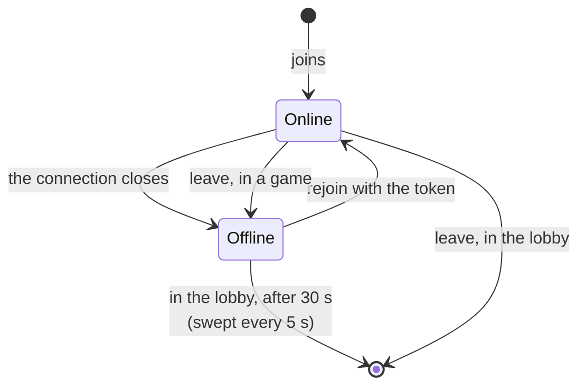

# 6. Presence and disconnections

Date: 2026-10-24 · Status: accepted (increment 1 is built with this ADR, increments 2 and 3 are proposed with a default for each choice)

## Context

[ADR 0003](0003-rooms-the-state-machine-and-the-protocol.md) made the server the keeper of who is connected: every player view carries a `connected` flag, and once the game has started `rejoin` with a token gives the seat back. Three things are still wrong or missing:

- **The lobby forgets at once.** Closing the connection removes the player, so a reload, a tunnel or a phone that sleeps loses the seat, the team and sometimes the host seat.
- **Presence is hardly visible.** "hors ligne" is a suffix after a name, and nobody is told who the game is waiting for.
- **An absent player blocks.** A Signaleur who leaves stops the turn for good ([ADR 0003](0003-rooms-the-state-machine-and-the-protocol.md), [ADR 0005](0005-the-table-by-role-and-phase.md)), and a game in progress cannot be watched by someone without a seat.

Those are three decisions of different sizes, so this ADR cuts the work in increments that ship one by one, and gives a default to each product choice so that none of them blocks the work: they are Lilian's to change.

## Decision

### Three increments

| # | Increment | What it adds |
|---|---|---|
| 1 | **Who is online** (built with this ADR) | A lobby keeps an absent player for a grace period, a `leave` message for leaving on purpose, everyone's presence shown in the lobby and at the table, the start refused while someone is offline, the table saying who the game waits for |
| 2 | **A missing Signaleur or host** ([#28](https://github.com/Didelo-lilian/semaphore/issues/28)) | A delay after which the turn passes, and the end of a game that nobody can play |
| 3 | **Spectators** ([#29](https://github.com/Didelo-lilian/semaphore/issues/29)) | Watch a game in progress without a seat, read only |

### Defaults of the product choices

| Choice | Default | Why |
|---|---|---|
| How long a lobby keeps an absent player (1) | 30 seconds, swept every 5 | Longer than the front's retries after a lost connection (0.5, 1, 2, 4 then 8 seconds) and a reload, short enough that the host does not wait for a ghost. A constant, not a setting |
| Starting with someone offline (1) | refused | They may be a Signaleur, and a Signaleur who is away blocks the first turn |
| "Quitter" (1) | the lobby seat goes at once; in a game the seat stays and shows offline, like a closed tab | The front forgets the token when it leaves, so nobody can claim the seat back; increment 2 can then skip the delay for someone who left on purpose |
| Host (1, 2) | in the lobby, the next player takes the host seat when the host's grace is over; once the game has started there is no transfer | The host's only power is to start the game, so after the start there is nothing to hand over |
| A Signaleur away during `SIGNAL`, or all the lookouts of the team in play away during `GUESS` (2) | the turn passes to the other team after 60 seconds | A reload and a bad network are under that. When the team's turn comes back and they are still away, the delay starts again |
| A team with nobody to play for it (2) | the other team wins after 5 minutes without its Signaleur | A game must be able to end. The sweep of idle rooms (30 minutes) only drops a room when nobody at all is connected |
| Replacing a missing Signaleur (2) | no | A lookout who became Signaleur would see the key, and the first Signaleur would return as a lookout who knows it: the reason the Signaleur is fixed for a grid ([ADR 0003](0003-rooms-the-state-machine-and-the-protocol.md)) |
| Spectators (3) | yes | A game with friends is worth watching, and it costs no rule |
| What a spectator sees (3) | what a lookout sees: the key only once the game has ended | With the key they could whisper it to a lookout |
| Spectator limit (3) | 20 per room, on top of the twelve players | Every change builds one view per connection under the room's lock |
| A spectator's seat (3) | none: no token, reloading the page goes through the link again | There is nothing to restore, and spectators do not keep a room alive |

### Increment 1

- **The lobby keeps an absent player.** `Room.disconnect` marks the player absent with the time, in the lobby as in a game, instead of removing them. `Room.dropAbsent` removes the lobby players absent for more than 30 seconds, and `GameSocketHandler` runs it every 5 seconds on every room and sends the new views, so the others see the host seat or the team count move. A `rejoin` within the grace period gives the seat back, as in a game.
- **Leaving on purpose** is a message of its own, `leave`, with no answer: in the lobby the player is removed at once, in a game they are marked absent like a closed connection. The client sends it, then closes. Without it, "Quitter" would leave a ghost for 30 seconds in everyone's lobby.
- **Starting needs everyone online**: the room refuses `start` with "everyone must be online". The refusal is the room's rule, the front only disables the button and says why.
- **The wire does not change** beyond `leave`: `connected` was already in every view.
- **The screens** show presence from the view alone, as the table does ([ADR 0005](0005-the-table-by-role-and-phase.md)): an absent player is dimmed and spelled "hors ligne" (never color alone, [ADR 0001](0001-name-rules-and-visual-direction.md)), the lobby and the table count "3 sur 4 en ligne", the host's start button is disabled while someone is away, and the table's live line says who the game waits for: the Signaleur of the team in play during `SIGNAL`, or its lookouts during `GUESS` when all of them are away.

## Consequences

- A player who drops from the lobby stays on the list as "hors ligne" for 30 to 35 seconds and gets their seat, team and host seat back if they return in time. The front's automatic reconnection now covers the lobby too.
- A room whose players are all away is still dropped by the sweep of idle rooms after 30 minutes ([ADR 0003](0003-rooms-the-state-machine-and-the-protocol.md)); an empty lobby is dropped the same way.
- The known limit of a missing Signaleur is unchanged until increment 2, but it is no longer silent: the table says who it is waiting for.
- The grace period is the same for every lobby and is not configurable: the tests move the clock, not a setting.
- Spectators and the countdowns of increment 2 will need a deadline in the view (or a spectator count); neither exists yet, and nothing in this increment prepares for them.
