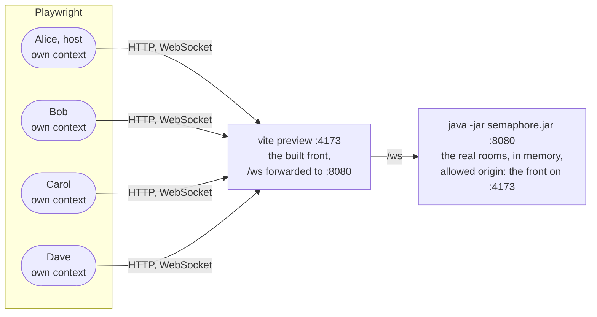

# 7. An end-to-end test of a whole game

Date: 2026-10-24 · Status: accepted

## Context

The rules are tested on the server ([ADR 0003](0003-rooms-the-state-machine-and-the-protocol.md)) and the screens on the front, through a fake socket ([ADR 0005](0005-the-table-by-role-and-phase.md)). Nothing tests the two together: a message that the front no longer reads, or a button that is not where a role should find it, is only seen by playing by hand. The v0.2.0 request ids were checked that way, with three simulated players on the production socket.

## Decision

One Playwright test plays one whole game with four players, from the creation of the room to "Retour à l'accueil", on every pull request.

- **The real backend and the built front, not the images.** The jar is built by the job, with the same Gradle setup as the `backend` job, and the front is served by `vite preview`, which forwards `/ws` like the dev server does, so the page and the socket share an origin as in production and the backend keeps checking it (`SEMAPHORE_ALLOWED_ORIGINS`). The front image is nginx without a proxy for `/ws` (Traefik does that in production): testing the images would need a proxy of their own, for what the `image` job already checks, that they build.
- **A browser context per player.** The seat is kept per tab in `sessionStorage` ([ADR 0004](0004-a-react-front-on-the-design-system.md)), so four people are four contexts. The players arrive one after the other, because the Signaleur of a team is its first player in the order of arrival in the room, not in the order of entry in the team: Dave picks Bâbord before Alice and Alice is still its Signaleur.
- **Deterministic despite the random grid.** The grid and the team that starts are drawn. The test reads the key where a Signaleur reads it, in the accessible names of the cards ("avion, caché, Bâbord"), reads whose turn it is in the title of the table, and has each team signal as many of its own words as it can (4 at most): the lookouts touch them one by one, pass, and the team that started has found its eight words on its second turn. The signal is a word that is not close to any of the 160 words of the list, so it is valid on any grid. The first signal of the game is a word of the grid on purpose: the server refuses it and the test checks that the front says why.
- **No sleeps, no retries.** Every step waits for what the page shows (Playwright's auto-waiting assertions), and a card is touched again only once the previous one has turned over, since the buttons are inert while a command waits for its answer. A flaky game must be seen, not hidden by a second chance.
- **Its own folder.** `e2e/` has its own `package.json` and lockfile, so `npm run check` of the front stays what it is and only the job that plays the game installs Playwright and Chromium.
- **A trace on failure only.** The trace holds the four pages, with a screenshot and the DOM at each step; the job uploads it as the `e2e-traces` artifact when it fails.

## Consequences

- The job runs on every pull request and every push to `main`. It is not a required check of the ruleset: that is a choice for the owner of the repository, to make once the job has proved steady.
- The test finds its way by the French labels of the screens, as a player does: rewording one breaks it, on purpose, and the unit tests of the screens break with it.
- A word added to `words.txt` that is too close to the signal of the test (it contains it, is contained in it or starts with its first four letters) makes the test fail with the server's refusal on the screen of the Signaleur.
- Not covered: coming back after a lost connection, a Signaleur who leaves, spectators ([ADR 0006](0006-presence-and-disconnections.md) has the presence rules, tested on the server and on the screens), and what stands in front of the application in production (Traefik, the images), which is checked by playing on `play.didelo.fr` after a release.
