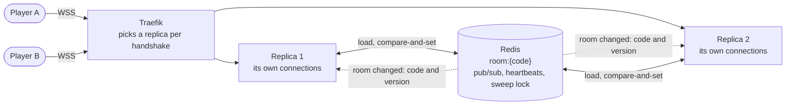
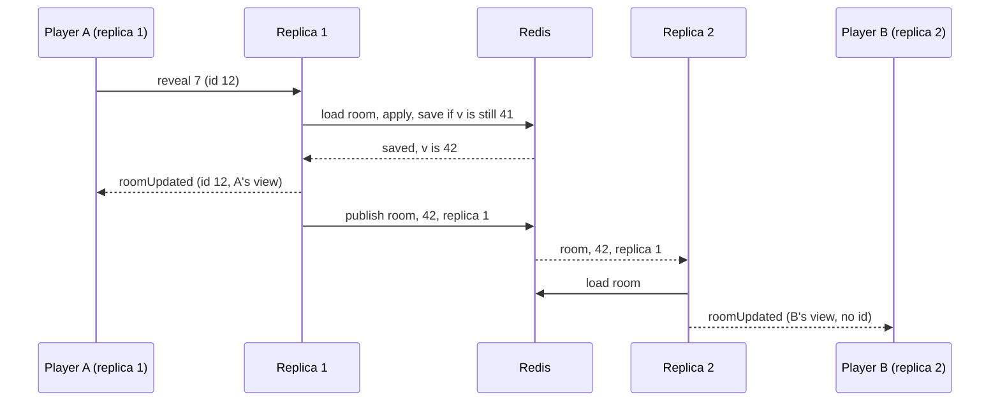

# 8. Rooms in Redis, shared by the replicas

Date: 2026-10-25 · Status: accepted (shared state in Redis is Lilian's choice; the numbers below are defaults to change)

## Context

Every room lives in the memory of the one backend ([ADR 0003](0003-rooms-the-state-machine-and-the-protocol.md)), under `synchronized(room)`. Two things follow:

- **A deploy ends every game.** The container restarts, every connection closes, every room is gone.
- **A second replica cannot serve a room the first one created.** The room code only arrives in the first message of a connection, after Traefik has already chosen the replica for the handshake, and the edge cannot read a WebSocket message. Sticky sessions do not help: a friend who types the code lands wherever the balancer sends them.

The plan for v0.4 is two replicas behind Traefik, so that a deploy rolls through them one at a time and a bad image reaches one only.

## Decision

- **The rooms live in Redis, not in the JVM.** A room is a hash `room:{code}` with two fields, `v` (its `version`) and `state` (the whole room as JSON: players with their tokens, the grid and its key, the phase, the spectator counts, the timestamps). `Room` stays the only place that knows the rules: it is loaded from the JSON, changed, and saved again. Redis is therefore a trust boundary (it holds the key and the tokens): it is reachable only by the backend, with a password ([infra ADR 0018](https://github.com/Didelo-lilian/infra/blob/main/docs/adr/0018-redis-for-the-games-rooms.md)).
- **A change is a compare-and-set on the version.** The replica loads the room, applies the command in Java, and saves it with a Lua script that writes only if `v` is still the version it loaded, then retries (a few times, then answers "try again") on a conflict. This replaces `synchronized(room)`: twelve players on one room make conflicts rare and cheap. A move that the rules refuse throws before anything is saved. Creating a room refuses a code that exists. The hash gets a TTL of 24 hours on every write, as a safety net only; a room is still dropped by the sweep once none of its players has been connected for 30 minutes, as today.
- **Every replica serves the connections it accepted, and nobody else's.** `seats` and `sessions` stay in the replica's memory, and a handshake never needs to know the room. After a change the replica sends its own connections their views, built from the room it just saved, and publishes `{code, version, replica}` on a Redis channel; every other replica that holds a connection of that room reloads it and sends its own connections their views. A replica ignores its own messages. The hidden cards never cross the channel: only the room's state in Redis holds them, and each replica builds each connection's view itself, so the rules of [ADR 0005](0005-the-table-by-role-and-phase.md) do not move. The answer to the sender still carries its `id`.
- **Pub/sub can lose a message**, so a replica also checks, every few seconds, the version of each room it holds a connection of, and sends the views again when it is behind; it does the same when its subscription comes back after a break. The clients already drop a view older than the one they show.
- **A `rejoin` works on any replica**, since the token is found in the room. The replica that takes it publishes `seatTaken {code, player, replica}`, and the replica that still holds an older connection of that player closes it with "replaced by a newer connection", as one replica does today.
- **Presence follows the replica, not the connection.** Each connected player carries the id of the replica that holds their connection. A replica writes a heartbeat key with a 15-second life every 5 seconds; the sweep marks absent every player whose replica has no heartbeat, then the usual grace of [ADR 0006](0006-presence-and-disconnections.md) applies (30 seconds in a lobby, 60 before the turn passes). A spectator count is kept per replica in the room and dropped with the replica. A replica that stops on purpose closes its connections with "going away" without writing anyone absent, and lets its heartbeat run out: the clients reconnect in under a second to the other replica and take their seat back, and only the ones who do not are marked absent, 15 seconds later.
- **The sweeps run once per tick, not once per replica.** `dropAbsent`, `expire`, the dead-replica check and `dropAbandoned` run under a short Redis lock (`SET NX PX`), and each step reloads the room and saves by compare-and-set, so a second run, after a lock that expired, does no harm. At the scale of this game (tens of rooms) one pass over every room a second is cheap; a sorted set of the next deadline per room is the upgrade, not needed yet.
- **The same code runs without Redis.** `RoomStore` (find, create, update by compare-and-set, all, drop) and `RoomEvents` (publish, subscribe) have an in-memory implementation, the default, used by development, the unit tests and the end-to-end test, and a Redis one chosen by `SEMAPHORE_REDIS_URL`. The in-memory one keeps today's lock and calls its listeners at once, so one process behaves as it did.

## Consequences

- **A deploy no longer loses a room.** Restarting a replica closes its connections only; its clients reconnect to the other one through `rejoin` (0.5 s first retry, [ADR 0006](0006-presence-and-disconnections.md)) and find the room as they left it. The edge's cap of 24 connections per address is not affected. A restart of Redis keeps the rooms too, if it persists to disk ([infra ADR 0018](https://github.com/Didelo-lilian/infra/blob/main/docs/adr/0018-redis-for-the-games-rooms.md)).
- **During a rolling deploy two versions of the backend share the same rooms.** A change to the stored JSON must therefore be additive for one release: the new code reads what the old one wrote, the old one ignores a field it does not know (Jackson's `FAIL_ON_UNKNOWN_PROPERTIES` stays off), and a field is removed one release after nobody writes it.
- **Redis is now a dependency of the game.** Without it, a replica refuses to create or join a room and says so; the rooms already loaded are not served from memory. The health check of the container does not include Redis (an unreachable Redis would restart a healthy backend), and a probe or alert on it comes with the infra stack.
- **More latency per command**: a load and a save over the internal network, about a millisecond each. The load test ([#38](https://github.com/Didelo-lilian/semaphore/issues/38)) puts a number on it, one replica and two.
- **Clocks.** `absentSince`, `lastMove` and the other timestamps are written by whichever replica handles the event; both replicas run on one host and share its clock. A second host would read the time from Redis instead.
- **Not covered**: the number of connections per replica is still bounded by the edge and by 384 MiB of heap; a replica that dies mid-command may have saved without sending the views, which the version check above repairs within seconds.

### Rejected

- **Sticky sessions with rooms in memory.** A room would live in the replica where it was created, but the code that names it arrives after the choice of the replica, so a joiner would be sent to the wrong one; the replicas would forward to each other (the shared channel and registry this ADR builds anyway), and a deploy would still lose the rooms of the replica that stops.
- **A distributed lock per room instead of compare-and-set.** One more thing to expire and to hold wrongly: a replica that stalls inside its lock blocks the room until the lock times out, where a conflict only costs a retry.
- **Publishing the room, or the views, on the channel.** It would put the key on a channel that every subscriber reads, and the messages would grow with the room; the code and the version are enough to wake a replica.
- **A database (Postgres) for the rooms.** It is planned for profiles and the leaderboard, but a room is changed several times a minute and only matters while it is played: a store with a TTL and a channel is the better fit.
