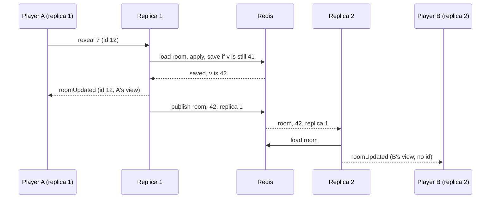

# 8. Rooms in Redis, shared by the replicas

Date: 2026-10-25 · Status: accepted and built (shared state in Redis is Lilian's choice; the numbers below are defaults to change)

## Context

Every room lives in the memory of the one backend ([ADR 0003](0003-rooms-the-state-machine-and-the-protocol.md)), under `synchronized(room)`. Two things follow:

- **A deploy ends every game.** The container restarts, every connection closes, every room is gone.
- **A second replica cannot serve a room the first one created.** The room code only arrives in the first message of a connection, after Traefik has already chosen the replica for the handshake, and the edge cannot read a WebSocket message. Sticky sessions do not help: a friend who types the code lands wherever the balancer sends them.

The plan for v0.4 is two replicas behind Traefik, so that a deploy rolls through them one at a time and a bad image reaches one only.

## Decision

- **The rooms live in Redis, not in the JVM.** A room is a hash `room:{code}` with two fields, `v` (its `version`) and `state` (the whole room as JSON: players with their tokens, the grid and its key, the phase, the spectator counts, the timestamps). `Room` stays the only place that knows the rules: it is loaded from the JSON, changed, and saved again. Redis is therefore a trust boundary (it holds the key and the tokens): it is reachable only by the backend, with a password ([infra ADR 0018](https://github.com/Didelo-lilian/infra/blob/main/docs/adr/0018-redis-for-the-games-rooms.md)).
- **A change is a compare-and-set on the version.** `RoomRegistry` loads the room, applies the command in Java and asks the store to save it if `v` is still the version it loaded; on a conflict it starts again from the newer room, five times at most, then answers "the server is busy, try again". This replaces `synchronized(room)`: twelve players on one room make conflicts rare and cheap. The Lua script only compares `v` and writes the text it is given: it never decodes the JSON, since Lua's cjson turns every empty array into an empty object. A move that the rules refuse throws before anything is saved. Creating a room refuses a code that exists, and dropping one is conditional on its version too. The hash gets a TTL of 24 hours on every write, as a safety net only; a room is still dropped by the sweep once none of its players has been connected for 30 minutes, as today.
- **Every replica serves the connections it accepted, and nobody else's.** `seats` and `sessions` stay in the replica's memory, and a handshake never needs to know the room. After a change the replica sends its own connections their views, built from the room it just saved, and publishes `{code, version, replica}` on a Redis channel; every other replica that holds a connection of that room reloads it and sends its own connections their views. A replica ignores its own messages. The hidden cards never cross the channel: only the room's state in Redis holds them, and each replica builds each connection's view itself, so the rules of [ADR 0005](0005-the-table-by-role-and-phase.md) do not move. The answer to the sender still carries its `id`. A replica remembers the last version it sent of each room and skips one it already has.
- **Pub/sub can lose a message**, so a replica also checks, every 3 seconds, the version of each room it holds a connection of, and sends the views again when it is behind; it does the same each time its subscription is confirmed, the first time and after a break. The same check sets right what the room says of the connections held here: a replica judged dead while its connections were fine had its players marked absent, so they are marked back; a player the room holds on another replica (a `seatTaken` was lost) has its old connection here closed; a player who is gone has its connection closed; and a disconnect that could not be written while Redis was out of reach is written now. The clients already drop a view older than the one they show.
- **A `rejoin` works on any replica**, since the token is found in the room. The replica that takes it publishes `seatTaken {code, player, replica}`, and a replica that holds an older connection of that player reads the room again and closes the connections the room does not give to it, with "replaced by a newer connection", as one replica does today. The room decides, not the message: two tabs of one player that rejoin at once on two replicas leave the one the room holds. A `rejoin` that finds Redis unavailable closes the connection with 1013 ("try again later") instead of answering an error: the front forgets its seat on any error to a rejoin, and a hiccup of Redis must not cost a player their seat, while a close makes it rejoin by itself.
- **Presence follows the replica, not the connection.** Each connected player carries the id of the replica that holds their connection. A replica writes a heartbeat key with a 15-second life every 5 seconds; the sweep marks absent every player whose replica has no heartbeat, then the usual grace of [ADR 0006](0006-presence-and-disconnections.md) applies (30 seconds in a lobby, 60 before the turn passes). A spectator count is kept per replica in the room and dropped with the replica. A connection that closes late on a replica that no longer holds the player (they rejoined elsewhere) changes nothing, since `Room.disconnect` only marks absent a player who still belongs to the replica of that connection. The dead-replica check runs only on a replica whose own heartbeat is there: one that cannot see itself cannot judge the others. A replica that stops on purpose closes its connections with "going away" without writing anyone absent, and lets its heartbeat run out: the clients reconnect in under a second to the other replica and take their seat back, and only the ones who do not are marked absent, 15 seconds later.
- **The sweeps run once per tick, not once per replica.** `dropAbsent`, `expire`, the dead-replica check and `dropAbandoned` run under a short Redis lock (`SET NX PX`, one per sweep, living a little less than its period: 0.9 s, 4.5 s, 4.5 s and 55 s), and each step reloads the room and saves by compare-and-set, so a second run, after a lock that expired, does no harm. A pass is a `SCAN` of `room:*` and one load per room. At the scale of this game (tens of rooms) one pass over every room a second is cheap; a sorted set of the next deadline per room is the upgrade, not needed yet.
- **The same code runs without Redis.** Three small interfaces carry what Redis does: `RoomStore` (find, create, replace if the version is the one loaded, codes, drop), `RoomEvents` (publish, subscribe) and `Cluster` (this replica's id, the replicas that are alive, a lock that is taken or not), which the first plan did not name. Each has an in-memory implementation, the default, used by development, the unit tests and the end-to-end test, and a Redis one chosen by `SEMAPHORE_REDIS_URL` (empty means none). The in-memory store does the same compare-and-set on a map and calls its listeners at once, so one process runs the code of two replicas and behaves as it did. The Redis ones use Lettuce directly, not Spring Data: one connection for the commands, one for the channel, no connection factory and no health indicator that Spring would add.

## Consequences

- **A deploy no longer loses a room.** Restarting a replica closes its connections only; its clients reconnect to the other one through `rejoin` (0.5 s first retry, [ADR 0006](0006-presence-and-disconnections.md)) and find the room as they left it. The edge's cap of 24 connections per address is not affected. A restart of Redis keeps the rooms too, if it persists to disk ([infra ADR 0018](https://github.com/Didelo-lilian/infra/blob/main/docs/adr/0018-redis-for-the-games-rooms.md)).
- **During a rolling deploy two versions of the backend share the same rooms.** A change to the stored JSON must therefore be additive for one release: the new code reads what the old one wrote, the old one ignores a field it does not know (Jackson's `FAIL_ON_UNKNOWN_PROPERTIES` stays off), and a field is removed one release after nobody writes it. A state that this version cannot read at all (a value of an enum it does not have) is answered like an unavailable Redis, "the server is busy", and a `rejoin` closes with 1013 and tries again once the deploy has gone through, instead of forgetting the seat.
- **Redis is now a dependency of the game.** Without it, a replica refuses to create or join a room with "the server is busy, try again" and stays up; the rooms already loaded are not served from memory. It connects when it first needs Redis and again after each failure, so the backend starts before Redis does and finds it later. A write that Redis refuses for memory (`maxmemory 64mb`, `noeviction`) is refused with "the server is full, try again later". The limit is Redis's, not a room's: while it holds, every write of every room is refused and the reads go on. The heartbeat and the locks are the exception, written by a Lua script flagged `allow-oom`: without it every replica would look dead after 15 seconds, and no sweep could take its lock to drop the abandoned rooms that free memory. The health check of the container does not include Redis (an unreachable Redis would restart a healthy backend): Lettuce is used directly, so nothing adds a Redis indicator to Actuator, and a test starts the backend where nothing listens and checks that `/actuator/health` is UP. A probe or alert on Redis comes with the infra stack.
- **More latency per command**, measured with `StoreCostIT` against a Valkey on the same machine, in a started room of four players (2.2 KB of JSON): a load costs about 0.2 ms, a save about 0.4 ms, and a whole command (load, apply, save) about 0.4 ms, against a microsecond in memory. The load test ([#38](https://github.com/Didelo-lilian/semaphore/issues/38)) puts a number on it under load, one replica and two.
- **Memory.** In the image, read-only with 384 MiB: about 128 MiB at rest without Redis, 156 MiB with the client, and 163 and 203 MiB with 25 rooms and 100 connections. Valkey holds a room in about 2 KB: 1.3 MB for those 25.
- **Clocks.** `absentSince`, `lastMove` and the other timestamps are written by whichever replica handles the event; both replicas run on one host and share its clock. A second host would read the time from Redis instead.
- **Not covered**:
  - The number of connections per replica is still bounded by the edge and by 384 MiB of heap; a replica that dies mid-command may have saved without sending the views, which the version check above repairs within seconds.
  - A replica that stalls for more than the 15 seconds of its heartbeat is judged dead and its players show offline until that replica hears of it or checks, a few seconds at most. The same happens after an outage of Redis longer than 15 seconds, when the first replica to beat again does not yet see the others. If a replica is down for good, its players are the ones who do not come back.
  - A disconnect that cannot be written is tried again every 3 seconds, but only while the replica lives: if it dies first, its heartbeat running out marks the player absent instead.
  - A room that cannot be read, such as one saved by a newer version of the backend during a rolling deploy, is skipped by the checks and the sweeps, which go on with the others, and tried again each time; its connections stay open. The same goes for a room that is dropped while a connection of it is held here, which only the closing of that connection ends.
  - A player who rejoins on a replica while that replica sets right the room can be shown absent for the few seconds until the next check puts them back, and a connection that has just joined can be sent a view of the room older than its `joined`, which the next one replaces. Both come from a window of one round trip to Redis.
  - While Redis cannot be reached at the network level, the calls that find no connection wait for the attempt that is running, one second at most, then fail at once for a second.
  - The sweeps read every room each time (`SCAN` and a load per room); the sorted set above is the way out when the rooms count in the thousands.

### Rejected

- **Sticky sessions with rooms in memory.** A room would live in the replica where it was created, but the code that names it arrives after the choice of the replica, so a joiner would be sent to the wrong one; the replicas would forward to each other (the shared channel and registry this ADR builds anyway), and a deploy would still lose the rooms of the replica that stops.
- **A distributed lock per room instead of compare-and-set.** One more thing to expire and to hold wrongly: a replica that stalls inside its lock blocks the room until the lock times out, where a conflict only costs a retry.
- **Publishing the room, or the views, on the channel.** It would put the key on a channel that every subscriber reads, and the messages would grow with the room; the code and the version are enough to wake a replica.
- **Spring Data Redis.** It would add a connection factory, a Redis health indicator that restarts a healthy backend when Redis is down, and beans that must be switched off when there is no URL; Lettuce, which it uses underneath, does the job with a handful of commands.
- **A database (Postgres) for the rooms.** It is planned for profiles and the leaderboard, but a room is changed several times a minute and only matters while it is played: a store with a TTL and a channel is the better fit.
