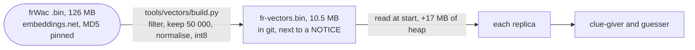

# 9. French word vectors for the bots

Date: 2026-10-25 · Status: proposed (the source and its licence wait for Lilian's decision)

## Context

A bot plays without a language model. The clue-giver looks for a word close to the words of its team and far from the others; the guesser ranks the cards by how close they are to the clue. Both need one thing: a vector for every French word, so that "close" is a number (the cosine of two vectors).

The vectors have to:
- fit in the JVM of each replica: two replicas, 384 MiB each, about 295 MiB used under the load test ([ADR 0008](0008-rooms-in-redis-shared-by-replicas.md));
- need no network at run time and cost nothing per game;
- be redistributable: the repository and the image are public, the code is MIT;
- be rebuilt from their source by a script anyone can run.

## Options

Two sources were looked at. The numbers of the first come from the file itself; those of the second are the sizes of its published files, which were not downloaded.

| | frWac, `skip`, 200 dimensions, cut 100 | fastText `cc.fr.300` |
|---|---|---|
| Author | Jean-Philippe Fauconnier | Facebook AI Research |
| Licence | **CC BY 3.0**, attribution only | **CC BY-SA 3.0**, share-alike |
| Trained on | frWaC, a web corpus of 1.6 billion French words | Common Crawl and Wikipedia |
| Size | 120 MB, 155 562 words, 200 dimensions, ordered by frequency | 300 dimensions, 1.3 GB as gzipped text or 4.5 GB as gzipped binary |
| Source of the licence | the author's page, read as raw HTML | the fastText page |

## Decision

- **The source is frWac** (`frWac_non_lem_no_postag_no_phrase_200_skip_cut100.bin`, MD5 `6b8605bb1fc726f44a895bff26057bae`). Its licence asks for the author's name with a link to the author's page and nothing else. The fastText licence would make the file we ship, which is an adaptation (words cut, vectors normalised and quantised), subject to share-alike: it would have to be published under CC BY-SA 3.0, with that notice next to a repository and an image that are otherwise MIT. That is workable, but it buys nothing here: frWac already holds far more words than the bots use, and the neighbours of `chat`, `avion` and `roi` are sensible.
- **The reduction** keeps the tokens made only of lowercase French letters, three letters or more (this drops punctuation, digits, elisions like `l'`, hyphenated compounds and the one- and two-letter words), the first 50 000 in the source's order, and any word of `words.txt` that falls outside them (one does today, `rateau`, at rank 52 886; a test checks that every word of the game is in the file). The order is the frequency order, so a word's rank is its index and a bot can skip the function words at the top or the rare words at the bottom. Each vector is normalised to unit length, then quantised to a byte with one global scale (the 99.99th percentile of the absolute values maps to 127).
- **The file** is a big-endian header (`FRV1`, version, number of words, dimensions, scale as a float), then the words (one length byte and the UTF-8 bytes), then `words × dimensions` signed bytes. The backend reads it with `DataInputStream`: no library.
- **It lives in git** under `backend/src/main/resources/bot/`, 10.5 MB, with a `NOTICE`. The build, the tests and the image then need no network and no third-party host. `tools/vectors/build.py` (run with `uv run`, numpy only) regenerates it from the pinned source URL and checksum; it is run again only if the rule above changes, and each regeneration adds about 10 MB to the history. Rejected: a release asset downloaded during the build (one more moving part, and the tests fail offline) and the 126 MB source downloaded on every build (from a personal page that may go away).
- **The attribution** is a `NOTICE` next to the file (the author's name, the link, the BibTeX entry from the author's page, the licence, and the sentence "adapted: words cut, vectors normalised and quantised"), copied into the jar, and a credits line in the README. A line in the front's footer is possible and left to Lilian.

## Measured

On the real file, 25 October 2026:

| | |
|---|---|
| Words kept | 50 001: the first 50 000 and `rateau`; the 160 words of the game are all inside |
| File | 10.46 MB as bytes; 20.5 MB if the vectors were half floats |
| Error of the byte quantisation | mean absolute error of 0.0007 on a cosine; 99.3 % of the ten nearest neighbours kept, over 500 words drawn at random |
| Load, JDK 25 in a container | 95 ms, heap +16.8 MB (10 MB of vectors, the rest is the words and their index) |
| One similarity scan of the 50 000 words | about 40 ms cold, and the bots need a handful per turn |

The implementation re-measures the heap and the start-up inside the real application and writes the numbers here.

## Consequences

- Each replica gains about 17 MB of heap. On 384 MiB with about 295 MiB used under load, that fits; if the measurement in the real application leaves too little room, the limit goes to 512 MiB in `infra`.
- **The vocabulary is a web crawl's.** It holds proper nouns and brands (`heathrow`, `klm`), and its neighbours lean on how the web writes: those of `roi` are historical. The clue-giver therefore skips the top ranks and filters its candidates; a stoplist is possible if the games show a need.
- **Neighbours include inflections** (`chat` has `chats` and `chatte`). A clue must not be a form of a word of the grid; the clue-giver enforces it with a rule on the letters, not with a lexicon ([#51](https://github.com/Didelo-lilian/semaphore/issues/51)).
- The licence is the author's and covers the vectors. No text of the corpus is distributed.
- Another source, or the same one with another rule, is a new file: the format carries a version, so a loader refuses a file it does not know.
