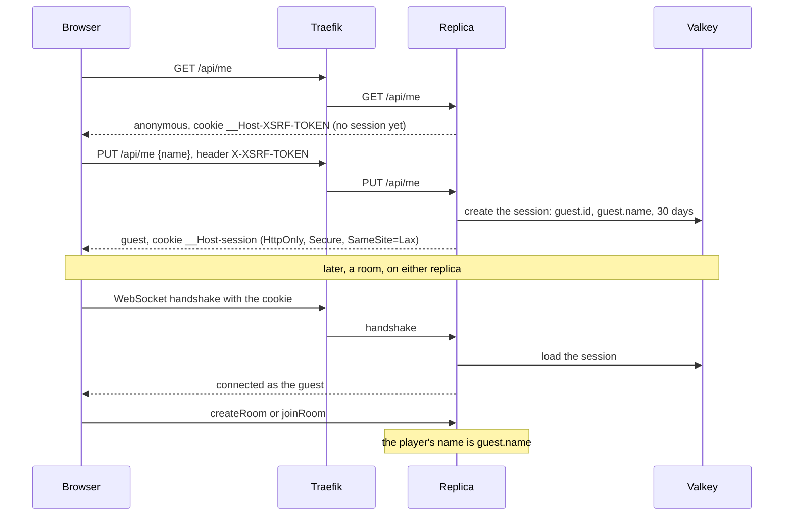

# 10. Guest sessions in Valkey

Date: 2026-10-25 · Status: proposed (the model below is recommended; what becomes of a guest who signs in later is Lilian's call, at the end)

## Context

A browser holds one thing today: the token of the room it sits in, in `sessionStorage`, and the server knows nobody outside a room ([ADR 0003](0003-rooms-the-state-machine-and-the-protocol.md)). A player types their name at every room. Sign-in with GitHub or Google (#54) and profiles (#55) need more: someone who is still the same person in the next room and on the next visit. A guest is that person without an account: a pseudo, remembered.

What constrains the answer:

- **Two replicas, no sticky sessions** ([ADR 0008](0008-rooms-in-redis-shared-by-replicas.md)). Any replica must read the session, and a rolling deploy must not sign anybody out.
- **Sign-in comes back from another site.** The browser leaves for GitHub or Google and returns, possibly to the other replica: the `state` of that flow has to be somewhere both replicas see.
- **Only `/ws` reaches the backend** (`infra/stacks/semaphore`). Everything else on `play.didelo.fr` is the front's nginx.
- **Valkey is outside the health check** and holds 64 MB with `noeviction` ([infra ADR 0018](https://github.com/Didelo-lilian/infra/blob/main/docs/adr/0018-redis-for-the-games-rooms.md)); a replica has 384 MiB.

## Decision

- **A server-side session: an opaque id in a cookie, the session in Valkey.** Spring Session's `RedisSessionRepository` (one hash per session with a time to live), and its `MapSessionRepository` without `SEMAPHORE_REDIS_URL`, like the rooms. Both replicas read it, a rolling deploy keeps it, and it is the `HttpSession` that Spring Security's login and OAuth2 client use, so #54 adds to it instead of replacing it.
- **A session exists only for a guest who chose a pseudo.** `PUT /api/me` creates it; nothing else does. A visitor, a crawler or a probe costs no memory.
- **It holds two plain strings**: `guest.id`, a UUID the server draws that stays the same for the life of the browser and through a sign-in, and `guest.name`. No class is stored, so a session written by one version of the backend is read by the next, whatever changes in between.
- **The cookie** is named with the `__Host-` prefix, which makes the browser insist on `Secure`, `Path=/` and no `Domain`, so a sibling subdomain of `didelo.fr` cannot plant a session cookie in this origin. It is `HttpOnly`, `Secure` and `SameSite=Lax`, lives 30 days and is renewed at each use (an idle timeout of 30 days). `Lax` and not `Strict`: the return from GitHub or Google is a cross-site navigation, a `Strict` cookie would not go with it and the flow would lose its `state`. `Lax` still keeps the cookie off a cross-site `PUT` or `DELETE`.
- **CSRF** is Spring Security's: a token cookie `__Host-XSRF-TOKEN` that the page reads and sends back in `X-XSRF-TOKEN` on `PUT` and `DELETE` (the double submit; the prefix keeps a sibling subdomain from planting its own token). `GET /api/me` hands the cookie out. The rest of Spring Security stays off: no login page, no basic authentication, and `/ws`, `/actuator/health` and `/api/**` are open, since what authorises a request is the session. The WebSocket keeps its check of the `Origin` header (`semaphore.allowed-origins`): its handshake is a `GET` without side effect.
- **Three verbs on `/api/me`.** `GET` answers `{"kind":"anonymous"}` or `{"kind":"guest","id":…,"name":…}` and never creates anything. `PUT {"name":…}` creates the guest or renames it and answers the same shape. `DELETE` forgets the guest (the session ends) and answers 204. #54 adds `"kind":"account"`. When Valkey cannot be reached the answer is 503 with "the server is busy, try again", the sentence of the rooms.
- **The pseudo follows the rule of the name in a room**: 1 to 20 characters once trimmed, one constant for `Room.join` and for `PUT /api/me`. Anything else is a 400. (The issue says "the name rules of ADR 0001", but that ADR has none for a player: the only rule is the one in `Room.join`.)
- **The WebSocket handshake reads the session** and copies `guest.id` and `guest.name` into the socket's attributes. `createRoom` and `joinRoom` take the player's name from there when it is present, and from the message's `name` as today when it is not. The messages keep their `name` field and the new front still sends it, so that during a rolling deploy an old replica understands the new front and a new replica the old one, and a browser without a session (cookies refused, Valkey out of reach) plays as before. A session store that cannot be reached at the handshake means no session, not a refused handshake.
- **Behind Traefik**: `server.forward-headers-strategy: native`, so that Tomcat sees `https` and the public host (the redirect of #54 is built from them). `Secure` is set by configuration, not guessed from the request. Traefik sends only `/ws` to the backend: `infra` gets a second router for `PathPrefix(/api)` on the same service, and a limit on the creation route stricter than the entry point's (30 requests a second per address, burst 100), since each `PUT` writes a hash in Valkey. That change is applied before the front that calls `/api` is deployed. A front that gets its own `index.html` for `/api/me`, because the router is not there yet, reads it as "no session" and asks the name in each room as before.
- **Dependencies**: Spring Security and Spring Session on Spring Data Redis. [ADR 0008](0008-rooms-in-redis-shared-by-replicas.md) rejected Spring Data Redis for the rooms; that still holds: the rooms stay on Lettuce. Spring Session is built on it, so it comes with its auto-configuration, its health indicator and its start-up `CONFIG SET` of keyspace events switched off, and with the beans created only when `SEMAPHORE_REDIS_URL` is set, as `RedisLink` is. A test starts the backend where nothing listens and checks that `/actuator/health` is UP, as for the rooms.

### What becomes of a guest who signs in later

This is the decision for Lilian. The code is #54 and #55; this ADR only has to keep the options open, which `guest.id` does.

| Option | What happens | Cost |
|---|---|---|
| **Fresh** | Signing in creates an account named after the provider; the guest session ends. The games of the guest stay under its id and are out of reach once it expires. | Nothing to build. The player loses their pseudo and their history. |
| **Adopt** (recommended) | The first sign-in creates the account with the guest's pseudo, which the player can change, and records `guest.id` as claimed by it: the games stored under that id (what is stored for guests is the choice of #55) become the account's. A guest id is claimed once. Signing in on a second device uses the account that exists; that device's guest games are claimed too if their id is still free. | One column and one update, in #54 and #55. Only the games of the browser that signs in are brought over. |
| **Choose** | The player picks which pseudo and which history to merge. | A screen and rules for conflicts, for a thing that happens once per player. |

**Recommendation: adopt.** It costs a stable `guest.id` kept through the session id change that Spring Security makes at login (attributes survive it), which this ADR already provides.

## Consequences

- **A rolling deploy signs nobody out.** The sessions are in Valkey and hold only strings. The routers and the cookie are the same for both replicas.
- **A guest is a browser.** Clearing cookies makes a new guest and another device is another guest. The cookie is the whole proof: whoever holds it is the guest, which is fine for a pseudo and is not for an account (#54 adds what it needs).
- **A session is a hash in the same Valkey as the rooms**, under the same `maxmemory` of 64 MB with `noeviction`. A flood of `PUT /api/me` would fill it as a flood of rooms would, answered as "the server is full, try again later". The limits at the edge are the defence, and the implementation measures what a session costs and writes it here.
- **Valkey losing its data loses the sessions**: with the append-only file every second, a second at most. A guest then types their pseudo again.
- **A browser that refuses a `Secure` cookie over plain HTTP** (Safari on `http://localhost`) falls back to naming the player in each room. Chromium accepts it on `localhost`, and so does the end-to-end test.
- **Memory and start-up** go up with Spring Security and Spring Data Redis; the implementation measures both against the 384 MiB of a replica and writes the numbers here.
- **Not covered**: a list of a guest's sessions or "sign out everywhere" (it needs the indexed repository, which is not worth it for a pseudo); a session that outlives a change of the cookie's name.

### Rejected

- **A signed cookie with no store.** No memory per guest, but a secret that both replicas share to deploy and rotate, no way to end a session, and the `state` and the login of #54 written by hand.
- **A session store of our own on Lettuce.** It would save the second client, but storage and expiry of sessions are what is not worth writing, and Spring Security expects an `HttpSession`.
- **Postgres for the sessions.** It is not there yet ([infra #95](https://github.com/Didelo-lilian/infra/issues/95)), and a session is read on every handshake.
- **`SameSite=Strict`.** It breaks the return from GitHub and Google.
- **Keeping the token per room and asking the name every time.** It is the state of today; it cannot carry an account.
