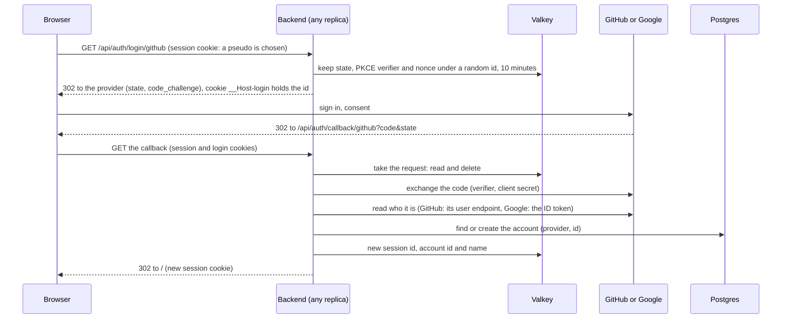

# 11. Sign in with GitHub or Google

Date: 2026-10-25 · Status: accepted (the account model and the data kept were confirmed by Lilian on 2026-11-01); amended on 2026-11-01 when it was built: where a login in flight waits, what `/api/me` says, and the three points that were to be confirmed

## Context

A browser's identity is a token per room today. The guest session of ADR 0010 gives it a pseudo and a cookie that outlive a room, kept in Valkey so both replicas read it. Signing in lets that session belong to an account that a player finds again on another device, and that the history and the leaderboard of ADR 0012 can attach games to.

What it has to respect:

- **No service in addition.** Spring Security does the OAuth2 client; there is no Keycloak or identity provider of our own (`docs/plan.md`).
- **GitHub and Google only.**
- **The least personal data that works.** A game of words needs a name to show, not a person.
- **A guest still plays.** So does a developer, a unit test and the end-to-end test with no provider configured.
- **Two replicas and rolling deploys.** A login in flight must survive landing on the other replica.

## Decision

- **Spring Security's OAuth2 client, authorization-code flow, with `state` and PKCE.** `state` is Spring's default. PKCE (S256) is opt-in for a client that has a secret: it is switched on with `OAuth2AuthorizationRequestCustomizers.withPkce()` on the authorization request resolver. Google supports it and GitHub accepts it since July 2025 without requiring it, so it protects the code on its way back and costs nothing if a provider ignored it. The flow runs on the backend: the browser never holds the provider's token. It runs on a security chain of its own that only the login and callback routes of the providers that are on reach, so an unknown provider is a plain 404 and every other route keeps the chain of ADR 0010.
- **Nothing the provider returns is kept.** The token is used once, to read who the player is, and dropped: the authorized-client repository keeps nothing (Spring's default would keep it in memory for as long as the process runs), and the OpenID user-info endpoint is not asked, since the ID token already says who the player is. The success handler finds or creates the account from the provider's id, writes only the account id and the name into the session of ADR 0010, and leaves Spring's `Authentication` to die with the request: the identity of the game is that session.
- **The routes sit under `/api/auth`**: `GET /api/auth/login/{provider}` starts the flow, `GET /api/auth/callback/{provider}` receives it, `POST /api/auth/logout` ends the session and `DELETE /api/auth/account` deletes the account. Traefik routes `/ws` and, with ADR 0010, `/api` to the backend; `/api/auth` is the prefix that gets a stricter rate limit. The callback addresses to register are `https://play.didelo.fr/api/auth/callback/github` and `https://play.didelo.fr/api/auth/callback/google`. The return address after a login is always `/`: no `redirect` parameter exists to be abused.
- **A login in flight waits in Valkey, not in the session.** Spring keeps the authorization request (the `state`, the PKCE verifier, the nonce) in the HTTP session by default. A visitor has no session until they choose a pseudo, the session holds plain strings only (ADR 0010), and a flood of starts would fill the store (64 MB, `noeviction`). So the request is kept as JSON under a random 256-bit id, for ten minutes, in Valkey (in memory without it), and the browser carries the id in the cookie `__Host-login` (`HttpOnly`, `Secure`, `SameSite=Lax`, `Path=/`, ten minutes). The callback takes it, reads and deletes in one command: a login is used once, and either replica finds it. Starting a login needs a pseudo, so a browser with no session cannot start one; a browser that does have one (a `PUT /api/me` is enough) can start several, each costing about 700 bytes for ten minutes, so a browser that starts again drops its earlier key, and Traefik limits how many one address starts. A session that already holds an account starts none: the start lands on `/`.
- **Where a login ends.** A login that succeeds lands on `/`. One that fails (consent refused, provider down, wrong `state`, no login cookie, a database that does not answer) lands on `/?login=failed`, a fixed code: nothing the provider sent is echoed. One that starts, or ends, with no pseudo in the session lands on `/?login=pseudo&provider=<id>`: the front asks for a pseudo and picks the login up again with that provider (the id is one of the providers that are on, and the front draws a button only for a provider it knows).
- **The least the providers give.** Google: the scope `openid` alone, an ID token whose `sub` is stable for this application. GitHub: no scope, the public profile, whose numeric `id` is stable (the `login` can change). Spring's built-in GitHub registration asks for `read:user`, and its builder cannot clear a scope once set, so GitHub's three addresses are declared in `Providers` and the registration has no scope: it reads the public profile only. Both are confirmed by the tests; that GitHub answers `GET /user` for a token with no scope is its documented behaviour, and is tried by hand with the real application. No e-mail, no real name, no avatar. The name shown in the game is the pseudo the player chose, validated by the rules of ADR 0001, as for a guest. Nothing personal is held beyond the provider's id, and the consent screens ask for nothing.
- **The account is one row.** A table `account`, created by a Flyway migration on the foundation of ADR 0012: `id` (a random UUID, never the provider's), `provider`, `subject` (the provider's id), `display_name`, `created_at`, unique on `(provider, subject)`. `game_player.account_id` references it (a foreign key, added by the same migration since the column exists by then), so a game cannot be recorded for an account that is not there: the record writes a seat whose account was deleted since the player joined as a guest's (`account_id` is read through a subselect), and the handshake that fills `Player.accountId` should still check the account, so the seat keeps it while it exists. Someone who signs in with both providers has two accounts: linking a second identity to one account needs a flow of its own and is not built (splitting an `account_identity` table off is a migration for the day it is wanted). Pseudos are not unique, as in a room, where players are told apart by id; how the leaderboard shows two players with one pseudo is for ADR 0012.
- **What a sign-in does to a guest.** The callback looks up `(provider, subject)`, and the player always has a pseudo, since a login does not start without one:
  - **Found**: the session becomes that account's, with the name of the account. The guest's pseudo is dropped.
  - **Not found**: the account is created with the session's pseudo.
  - Either way the session id changes at login (against session fixation; with sessions in Valkey the old key is deleted), and the `guest.id` of the browser stays.
  - **A guest and an account are never merged.** The games of a guest are not stored (ADR 0012), so the guest has nothing the account would take over, and no one can claim someone else's pseudo or history by signing in. Signing in is offered on the home page, outside a room: the full-page redirect to the provider closes the WebSocket, and the room token the browser keeps would only let the player come back as the guest they were.
  - **`GET /api/me`** answers `account` for a session that names one, with the account's `id` and name, and lists the `providers` that are on to an anonymous visitor and a guest (an empty list when none is), so the front draws exactly their buttons. The account is read from Postgres at each call: when it was deleted from another browser the session goes back to being a guest's, with the name it had, and when it was renamed the session takes the new name, which is the one a room reads at the handshake. With the database out of reach the session answers alone (ADR 0013: the game does not need it). An account session does not outlive the cookie: the login time (`account.at`) is kept with `account.id`, and after `semaphore.session.cookie-max-age` (30 days) the session is a guest's again, since each use renews a session in Valkey and a copied cookie would otherwise hold the account for good; deleting the account needs a login younger than that. **`PUT /api/me`** renames the account too.
- **A player in a room.** The identity the WebSocket handshake reads from the session gains the account id, absent for a guest. A `Player` keeps it, nullable, so ADR 0012 can attribute a finished game to an account. A client never sends an account id: it comes from the session or not at all.
- **Sign-out** is `POST /api/auth/logout` with the CSRF token of ADR 0010: it deletes the session, and the browser is a visitor again. **Deletion** is `DELETE /api/auth/account`, same protection (so is the chain of the login and callback routes, which uses the same token repository: a `GET` never needs a token, anything else on those routes is refused without it), with a confirmation in the front: it deletes the row and ends the session that asked, in one transaction with `GameHistory.forget` (which locks the games first, so two people of one game forgotten at once still drop it) (ADR 0012's rule: the account's seats become "a former player" and a game with no account left is dropped), so nothing points to the id when the row goes. The other browsers signed in to that account are not listed (ADR 0010 gives no way from an account to its sessions): each learns at its next `/api/me`, which finds no account. The login start is a `GET` that only redirects, and `state` is what protects the callback from a forged one.
- **A provider is optional.** The backend builds a registration for a provider only when both `semaphore.auth.<provider>.client-id` and `semaphore.auth.<provider>.client-secret` are not blank. Own properties, not `spring.security.oauth2.client.registration.*`: Boot refuses a registration with a blank client id, and the point is to start without. `GET /api/me` lists the providers that are on and the front draws only their buttons; with none, the game is what it is today. The four values arrive as files read by `configtree` like the Redis address ([infra ADR 0020](https://github.com/Didelo-lilian/infra/blob/main/docs/adr/0020-two-replicas-of-the-backend.md)). The ids are not secret but one mechanism is simpler, and keeps all four out of Compose and `docker inspect`. Infra writes an empty file for a value not in SOPS yet, which reads as blank.
- **The front.** The home page, outside a room and outside an invitation, draws one button per provider that `GET /api/me` lists to a browser that is not signed in (none when the list is empty). A button saves the pseudo first (`PUT /api/me`, so the login does not start without one and comes back asking for it), then leaves for `/api/auth/login/{provider}`; the pseudo field is the one of the home page, so a visitor who has not typed one cannot click. A browser that is signed in sees the name of its account, a sign-out (`POST /api/auth/logout`) and a deletion (`DELETE /api/auth/account`) that asks for a confirmation and says what becomes of the games; both carry the CSRF token of ADR 0010, and the page reads `/api/me` again after them. `/?login=failed` says the login failed, `/?login=pseudo` asks for the pseudo and offers to continue with the provider that was asked. A signed-in player enters a room as such: the handshake reads the account in the session, and the history writes it with the game (ADR 0012).
- **A provider that is down is not the game that is down.**
  - The endpoints are fixed, not discovered: a Google outage must not stop the backend from starting. The keys that sign Google's ID tokens are fetched at the first login and cached.
  - The calls to the token, user and key endpoints get a timeout of 3 seconds to connect and 5 to read, which for the JDK client runs until the response headers: a provider that sends them and then stalls the body still holds a thread (Spring's default has no timeout at all; bounding the body is a follow-up).
  - A failed login lands on `/?login=failed`, and so does one that meets Valkey or the database out of reach, at its start or at its callback, instead of the JSON 503 of the API.
  - Guests are not affected.
- **Tests never reach a real provider.** `mock-oauth2-server` runs inside the JVM for the integration tests: as Google's (an ID token), and as GitHub's (its authorization, token and user-info addresses replace the real ones, and the user-info carries an `id`, which the fake gives for the claims of the access token). It only knows OpenID requests, so the test adds `openid` to GitHub's authorization request when it plays the browser; the rest of the request is unchanged. The tests check that `state` and the PKCE challenge are sent and that the code is exchanged with the verifier of that challenge, that a wrong `state`, a missing login cookie, a replayed callback and a refused consent end on `/?login=failed`, that two logins of one identity give one account and the same id at two providers give two, that the session id changes and the old one is dead, that the provider's token and the client secrets are nowhere in Valkey, that a login started on one replica ends on the other, that a code exchange whose headers never come fails after five seconds, that deleting the account is seen by another browser at its next call, and that with no provider (or no database) no route starts a login. The end-to-end job does not sign in: it needs a front with the buttons, and the fake as a container. The real providers are tried once by hand, after Lilian registers the applications.

## Consequences

- **Lilian registers two OAuth applications**, one at GitHub and one at Google, with the callback addresses above, and stores the four values in SOPS (the steps are in infra's runbook `oauth-applications`). Local development uses applications of its own, with callback addresses on the port of the backend (`http://localhost:8080/api/auth/callback/...`); the tests use the fake provider.
- **Order.** The session of ADR 0010 and the persistence of ADR 0012 land first; this builds on both. The cookie must be `SameSite=Lax`, not `Strict`: the way back from the provider is a navigation from another site, and a `Strict` cookie is not sent on it, so `state` would be lost and every login would fail.
- **Infra, with the code.** Compose mounts the four files and a label of their hash recreates the replicas when one changes (the Redis password does the same), and `/api/auth` gets a router of its own with a strict rate limit.
- **The backend reaches the providers** (GitHub, Google) over HTTPS from the `edge` network; the `game` network is internal and does not.
- **A lost provider account is a lost game account.** A player who loses their GitHub account loses the game account behind it, since there is no e-mail to recover with. Accepted for a game.
- **Not built**: linking two providers, e-mail, avatars, other providers, recovery.
