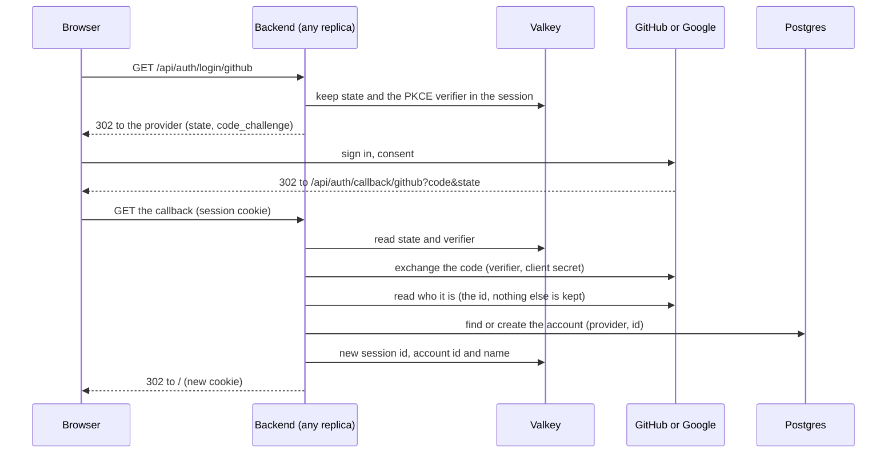

# 11. Sign in with GitHub or Google

Date: 2026-10-25 · Status: proposed (the account model and the data kept are defaults for Lilian to change)

## Context

A browser's identity is a token per room today. The guest session of ADR 0010 gives it a pseudo and a cookie that outlive a room, kept in Valkey so both replicas read it. Signing in lets that session belong to an account that a player finds again on another device, and that the history and the leaderboard of ADR 0012 can attach games to.

What it has to respect:

- **No service in addition.** Spring Security does the OAuth2 client; there is no Keycloak or identity provider of our own (`docs/plan.md`).
- **GitHub and Google only.**
- **The least personal data that works.** A game of words needs a name to show, not a person.
- **A guest still plays.** So does a developer, a unit test and the end-to-end test with no provider configured.
- **Two replicas and rolling deploys.** A login in flight must survive landing on the other replica.

## Decision

- **Spring Security's OAuth2 client, authorization-code flow, with `state` and PKCE.** `state` is Spring's default. PKCE (S256) is opt-in for a client that has a secret: it is switched on with `OAuth2AuthorizationRequestCustomizers.withPkce()` on the authorization request resolver. Google supports it and GitHub accepts it since July 2025 without requiring it, so it protects the code on its way back and costs nothing if a provider ignored it. The flow runs on the backend: the browser never holds the provider's token.
- **Nothing the provider returns is kept.** The token is used once, to read who the player is, and dropped: the authorized-client repository keeps nothing (Spring's default would write the token in the session, that is in Valkey). The success handler reads the provider's id, finds or creates the account, writes only the account id into the session of ADR 0010, and clears Spring's security context: the identity of the game is that session, not Spring's `Authentication`.
- **The routes sit under `/api/auth`**: `GET /api/auth/login/{provider}` starts the flow, `GET /api/auth/callback/{provider}` receives it, `POST /api/auth/logout` ends the session and `DELETE /api/auth/account` deletes the account. Traefik routes only `/ws` to the backend today; with ADR 0010's routes under `/api` too, one rule (`/api` and `/ws`) is enough, and one prefix is the place for a rate limit. The callback addresses to register are `https://play.didelo.fr/api/auth/callback/github` and `https://play.didelo.fr/api/auth/callback/google`. The return address after a login is always `/`: no `redirect` parameter exists to be abused.
- **The least the providers give.** Google: the scope `openid` alone, an ID token whose `sub` is stable for this application. GitHub: no scope, the public profile, whose numeric `id` is stable (the `login` can change). No e-mail, no real name, no avatar. The name shown in the game is the pseudo the player chose, validated by the rules of ADR 0001, as for a guest. Nothing personal is held beyond the provider's id, and the consent screens ask for nothing.
- **The account is one row.** A table `account`, created by a Flyway migration on the foundation of ADR 0012: `id` (a random UUID, never the provider's), `provider`, `subject` (the provider's id), `display_name`, `created_at`, unique on `(provider, subject)`. Someone who signs in with both providers has two accounts: linking a second identity to one account needs a flow of its own and is not built (splitting an `account_identity` table off is a migration for the day it is wanted). Pseudos are not unique, as in a room, where players are told apart by id; how the leaderboard shows two players with one pseudo is for ADR 0012.
- **What a sign-in does to a guest.** The callback looks up `(provider, subject)`:
  - **Found**: the session becomes that account's, with its pseudo. The guest's pseudo is dropped.
  - **Not found**: the account is created with the session's pseudo, or, for a visitor who has none yet, the player is asked for one when they land back on `/`, with the prompt a guest gets.
  - Either way the session id changes at login (against session fixation; with sessions in Valkey the old key is deleted).
  - **A guest and an account are never merged.** The games of a guest are not stored (ADR 0012), so the guest has nothing the account would take over, and no one can claim someone else's pseudo or history by signing in. Signing in is offered on the home page, outside a room: the full-page redirect to the provider closes the WebSocket, and the room token the browser keeps would only let the player come back as the guest they were.
- **A player in a room.** The identity the WebSocket handshake reads from the session gains the account id, absent for a guest. A `Player` keeps it, nullable, so ADR 0012 can attribute a finished game to an account. A client never sends an account id: it comes from the session or not at all.
- **Sign-out** is `POST /api/auth/logout` with the CSRF token of ADR 0010: it deletes the session, and the browser is a visitor again. **Deletion** is `DELETE /api/auth/account`, same protection, with a confirmation in the front: it deletes the row and ends every session of that account; what points to it (history) is anonymised by ADR 0012's rule. Ending *every* session needs a way from an account to its sessions: it depends on the session store ADR 0010 chooses and is settled when that lands. The login start is a `GET` that only redirects, and `state` is what protects the callback from a forged one.
- **A provider is optional.** The backend builds a registration for a provider only when both `semaphore.auth.<provider>.client-id` and `semaphore.auth.<provider>.client-secret` are not blank. Own properties, not `spring.security.oauth2.client.registration.*`: Boot refuses a registration with a blank client id, and the point is to start without. A route lists the providers that exist and the front draws only their buttons; with none, the game is what it is today. The four values arrive as files read by `configtree` like the Redis address ([infra ADR 0020](https://github.com/Didelo-lilian/infra/blob/main/docs/adr/0020-two-replicas-of-the-backend.md)). The ids are not secret but one mechanism is simpler, and keeps all four out of Compose and `docker inspect`. Infra writes an empty file for a value not in SOPS yet, which reads as blank.
- **A provider that is down is not the game that is down.**
  - The endpoints are the built-in ones of `CommonOAuth2Provider`, not discovery: a Google outage must not stop the backend from starting.
  - The calls to the token and user endpoints get a timeout of 3 seconds to connect and 5 to read (Spring's default has none, and a provider that hangs would hold the threads of a small pool).
  - A failed login (consent refused, provider down, wrong `state`) lands on `/?login=failed`, a fixed code: nothing the provider sent is echoed.
  - Guests are not affected.
- **Tests never reach a real provider.** `mock-oauth2-server` runs inside the JVM for the integration tests, as the Google registration, and as a stand-in for GitHub's (its authorization, token and user-info addresses replace the real ones and the user-info carries an `id`); the same server runs as a container in the end-to-end job. The tests check that `state` and the PKCE challenge are sent, that a wrong `state` is refused, that two logins of one identity give one account, that the session id changes, that the provider's token is nowhere in Valkey, and that with no provider configured no route starts a login. The real providers are tried once by hand, after Lilian registers the applications.

## Consequences

- **Lilian registers two OAuth applications**, one at GitHub and one at Google, with the callback addresses above, and stores the four values in SOPS (the steps are in infra's runbook `oauth-applications`). Local development uses the fake provider, or applications of its own with `http://localhost:5173/api/auth/callback/...`.
- **Order.** The session of ADR 0010 and the persistence of ADR 0012 land first; this builds on both. The cookie must be `SameSite=Lax`, not `Strict`: the way back from the provider is a navigation from another site, and a `Strict` cookie is not sent on it, so `state` would be lost and every login would fail.
- **Infra, with the code.** The backend's router rule widens from `/ws` to `/api` and `/ws`, Compose mounts the four files and a label of their hash recreates the replicas when one changes (the Redis password does the same), and `/api/auth` gets a rate limit.
- **The backend reaches the providers** (GitHub, Google) over HTTPS from the `edge` network; the `game` network is internal and does not.
- **A lost provider account is a lost game account.** A player who loses their GitHub account loses the game account behind it, since there is no e-mail to recover with. Accepted for a game.
- **Not built**: linking two providers, e-mail, avatars, other providers, recovery.
