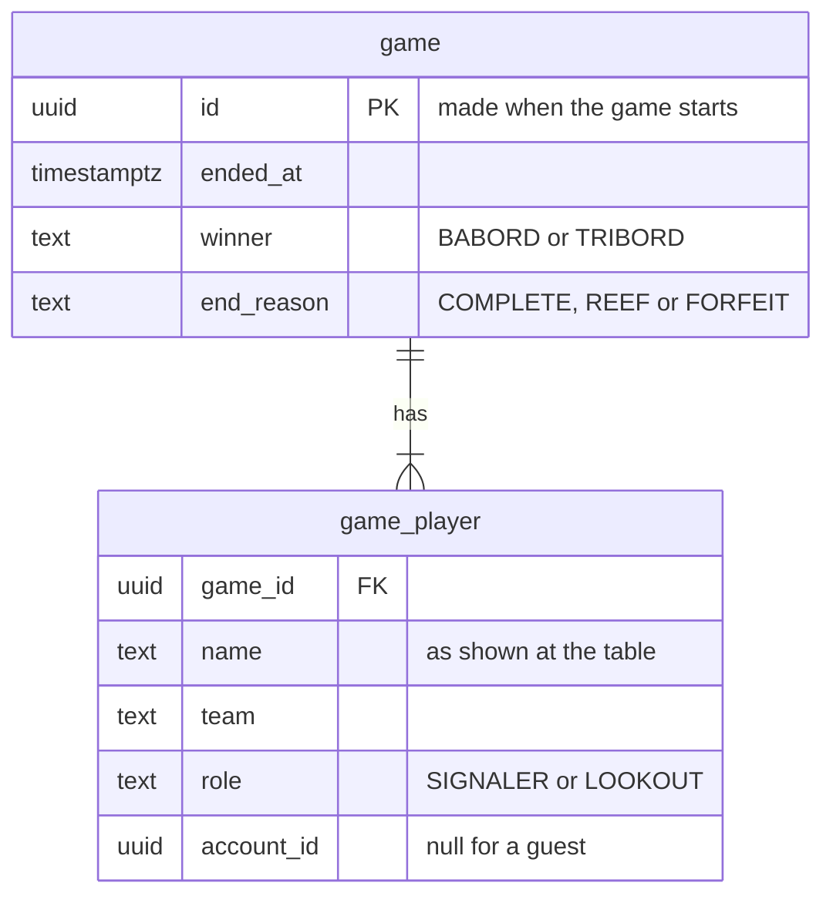
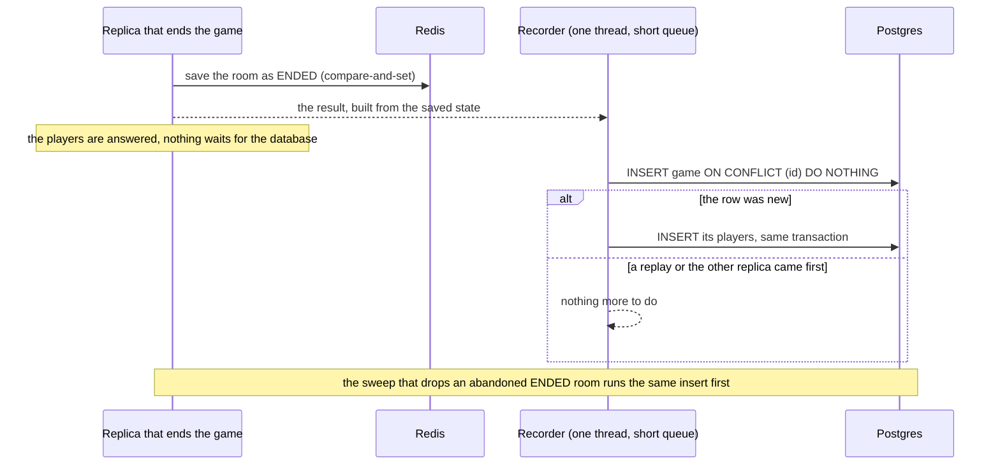

# 12. Finished games, profiles and the leaderboard

Date: 2026-10-25 · Status: proposed (what is kept about guests and for how long is Lilian's call; the numbers are defaults to change)

## Context

A room is gone a day at most after its game ([ADR 0008](0008-rooms-in-redis-shared-by-replicas.md)), and nothing says who played it afterwards. Accounts are coming (sign-in with GitHub or Google, [#54](https://github.com/Didelo-lilian/semaphore/issues/54)) on top of the guests of [#49](https://github.com/Didelo-lilian/semaphore/issues/49), and with them a profile, a history and a leaderboard ([#55](https://github.com/Didelo-lilian/semaphore/issues/55)). Postgres, Flyway and `JdbcClient` are in place for it ([ADR 0013](0013-postgres-with-flyway-and-a-plain-jdbc-client.md)). This decision sets what is kept of a finished game, who it is kept for, how it is written exactly once by two replicas, what a profile and the ranking are, and what happens to it all when an account is deleted.

## Decision

- **A game is kept when it has ended, once, with who played it.** A `game` row (its id, when it ended, the winning team and how it ended) and one `game_player` row per seated player (the name shown at the table, the team, the role, and the account if there is one). Spectators are not kept, nor the grid, the signals or the moves: the history shows results, not replays.
- **The game gets an id when it starts.** `Room` puts a UUID in the state at `Start` (`RoomState.gameId`, an additive field as [ADR 0008](0008-rooms-in-redis-shared-by-replicas.md) asks: a room saved without it reads as a game with no id) and its end time when it ends (`RoomState.endedAt`), since a retry must not write the time of the retry. A room code is not enough, since codes are reused. A game started by the version before this one has no id and is not kept, once. A player carries a nullable `accountId` in the state, empty for a guest, which sign-in fills when a signed-in player joins.
- **How it ended is read from the state, not stored in it.** `REEF` when a team has no flag left, `COMPLETE` when a team has all its words revealed (the winner is the team whose words they are, even if the other team revealed the last one), `FORFEIT` when the game ended for lack of a Signaleur ([ADR 0006](0006-presence-and-disconnections.md)). The role is read the same way: the Signaleur is the first member of the team in the order they joined, for the whole grid.
- **Only games with at least one account are kept** (Lilian's decision, recommended). A profile and a history belong to accounts; a game of guests only has nobody to show it to, and keeping the pseudos that strangers typed, with nothing in return, is a liability for no feature. In a game that is kept, the guests' rows stay, with their pseudo and `account_id` empty, so that the history can show the whole table. The alternative, keeping every game, would allow a counter of games played and costs the pseudos of guests; it can be taken later without a migration, by dropping the rule.
- **Written once, by whichever replica ends the game.** In `RoomRegistry.update`, after the compare-and-set that saves the room as `ENDED`, the replica hands a `GameResult` built from the saved state to a recorder that runs on a thread of its own with a short bounded queue, so the answer to the players and the Redis loop never wait for Postgres. The recorder inserts the `game` row with `ON CONFLICT (id) DO NOTHING` and, only when that row was new, its players, in one transaction: a replay, or the other replica, finds the row and does nothing. The same insert is run by the sweep that drops an abandoned `ENDED` room, just before it drops it, so a game whose write failed (Postgres down, a replica killed between the save and the insert) is written the next time Postgres is back, until 30 minutes after its last player left. Without a database the recorder is not there, and a failed write is logged, never raised: the game is never refused or undone because of Postgres.

- **A profile is counted from the rows, not stored.** For an account: games played, games won, the win rate, and the same split by role (Signaleur or lookout). It is an aggregate over `game_player` joined to `game` with an index on `account_id`, which is cheap for hundreds of games per account and has nothing to keep in step. Games that ended by `FORFEIT` appear in the history but do not count in the numbers: a team that walks away would hand its opponents a win, and two friends could farm one.
- **The ranking is the win rate, for the accounts with at least 10 counted games.** Ties go to the one who played more, then to the most recent win. The first 50 are listed. A minimum number of games keeps one lucky game from topping the list, and is easy to explain on the page; the lower bound of the Wilson interval ranks better and is the upgrade if the list is gamed. The ranking is all-time for now.
- **What is public and what is not.** The leaderboard and a profile (display name, the counted games, wins and rate) are public. The history, which shows who sat at the table and when, is for its own account only, behind the session of [#49](https://github.com/Didelo-lilian/semaphore/issues/49), listed newest first, 20 at a time.
- **Deleting an account removes the person and keeps the table.** In one transaction the account's `game_player` rows lose their `account_id` and their name becomes "a former player", then every game left with no account in it is deleted (it no longer has anyone to belong to). The other players' history and numbers do not change. The endpoint belongs to sign-in; the history side (`GameHistory.forget`) is built here and tested, so sign-in only calls it.
- **No expiry** (Lilian's decision, recommended). A game with an account in it is kept for as long as that account lives; the pseudos of guests in it go when the last account goes. A rolling purge (say 12 months) is a scheduled job to write and test for a risk the data does not show yet: a few dozen accounts and short pseudos.
- **The account link has no foreign key yet.** `account_id` is a plain nullable `uuid`; the migration of [#54](https://github.com/Didelo-lilian/semaphore/issues/54) that creates the table of accounts adds the key and the index (`ON DELETE` is not needed, deletion goes through `GameHistory.forget`).

## Consequences

- **Nothing is kept until sign-in ships.** With "at least one account", a backend that has no accounts writes nothing; the recorder is built and tested with accounts made by the tests, and sign-in ([#54](https://github.com/Didelo-lilian/semaphore/issues/54)) only has to fill `accountId` for it to work. It is the order of the milestones anyway: v0.6 (sign-in) is before v1.0.
- **A game that is played across a rolling deploy can go unrecorded.** A replica of the previous version that saves the room does not know `gameId` or `accountId` and writes the room without them, so the game ends with no id or no account. The history is best effort at the edge of a deploy, as the game is ([ADR 0008](0008-rooms-in-redis-shared-by-replicas.md)).
- **A game that ends while Postgres is down for good is lost.** Written again by the sweep for as long as the room lives, then gone; the log says so. That is a loss of a line of history, not of a game.
- **A replica that ends a game does an insert it did not do before**, a millisecond or two off the hot path; the k6 profile must keep passing and gets a database in a later change if it shows nothing otherwise.
- **The numbers are those of the day.** A profile or a ranking is recomputed on each read: at this size it costs less than caching it, and a page that is read often is the first thing to cache if it gets slow.
- **Not covered**: an account that signs in from two providers is two accounts; two accounts of one person are two profiles; the names on the leaderboard are the display names of the providers (what [#54](https://github.com/Didelo-lilian/semaphore/issues/54) decides to keep) and are moderated by nobody.

### Rejected

- **Keeping every game, guests included.** More data, no reader: see above.
- **Counters per account, updated at the end of each game.** Two replicas and retries make a counter drift; the rows are the truth and the aggregate is derived.
- **A materialised leaderboard.** A table to refresh and to invalidate, for a query that reads a few thousand rows.
- **An Elo rating.** It needs a rating for each team of unequal size and for a Signaleur against lookouts; a win rate with a minimum number of games says what players mean by "good".
- **Keeping the moves to replay a game.** It would double what is stored per game and put the key in the database; results are what a profile needs.
- **Writing the result in the browser's name** (a request from the client at the end). The server is the authority of the game ([ADR 0003](0003-rooms-the-state-machine-and-the-protocol.md)); a client could write a game that was never played.
