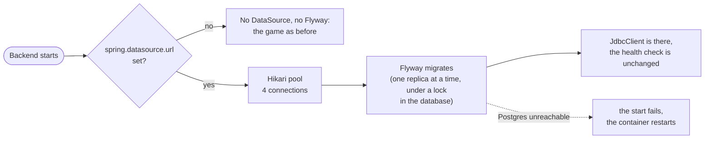

# 13. Postgres, with Flyway and a plain JDBC client

Date: 2026-10-25 · Status: accepted

## Context

A room lives in Redis for a day at most ([ADR 0008](0008-rooms-in-redis-shared-by-replicas.md)). Accounts, the history of finished games and the leaderboard have to outlive it, and Postgres is the database planned for them ([infra](https://github.com/Didelo-lilian/infra/issues/95)). This decision only sets the plumbing: how the backend reaches Postgres, how the schema changes, and what a missing database means. What is stored, and why, comes with the change that stores it.

## Decision

- **The database is optional, like Redis.** `spring.datasource.url` set to something (an empty value means none) gives a `DataSource`, Flyway and a `JdbcClient`; without it there is no connection, no migration and no table, and development, the unit tests, the end-to-end test and the load profile run as they did. Spring Boot's own setup would fail to start without a URL, so `SemaphoreApplication` excludes `DataSourceAutoConfiguration` and `Database` defines the `DataSource` from the same `spring.datasource.*` properties and `spring.datasource.hikari.*`; Flyway and the `JdbcClient` are still configured by Spring from that bean. A bean that needs the database is marked `@WithDatabase`, as one that needs Redis is `@WithRedis`.
- **The settings are three properties.** `spring.datasource.url` (`jdbc:postgresql://host:5432/name`) and `spring.datasource.username` come from the environment; `spring.datasource.password` comes from a secret file, read with `SPRING_CONFIG_IMPORT=configtree:/run/secrets/` as the Redis address is ([infra ADR 0020](https://github.com/Didelo-lilian/infra/blob/main/docs/adr/0020-two-replicas-of-the-backend.md)). The password is not in the URL: drivers and Flyway log the URL.
- **Flyway migrates when the backend starts, with the role the backend uses**, which therefore owns the schema. Two replicas that start together are serialised by the lock Flyway takes in the database. The files are `db/migration/V<n>__<name>.sql`, forward only.
- **A migration is additive for one release**, like the JSON of a room: during a rolling deploy the old version runs on the schema the new one has just migrated, and a canary that rolls back leaves its migration in place. A column is added nullable or with a default, a table is added; a column or a table is dropped or renamed one release after nothing reads it.
- **The SQL is written by hand, through `JdbcClient`.** The model is a few tables and a handful of queries (write a finished game once, list a player's games, count wins, rank): no entity to map, no lazy loading, no second cache, and the SQL is in the pull request. Rows are read into records.
- **Postgres is out of the health check** (`management.health.db.enabled: false`), as Redis is: a database that is down must not take both replicas out of Traefik, and the game does not wait for it. `DatabaseDownIT` stops Postgres and checks that the health stays up with no `db` component.
- **A pool of 4 connections per replica**, and 2 seconds to get one instead of Hikari's 30, so that a database that does not answer does not hold a request.
- **Tests start a real Postgres** (17, with Testcontainers, as Valkey is started): `DatabaseIT` (the migrations ran, a query works), `DatabaseDownIT` (the health with Postgres stopped) and `NoDatabaseTest` (no `DataSource`, no Flyway without a URL; every other test of the backend already runs without one).

## Consequences

- **A replica does not start while Postgres is unreachable**, since Flyway fails: Docker restarts it until the database answers, the other replica keeps serving, and a deploy made while Postgres is down fails its canary and rolls back ([infra ADR 0019](https://github.com/Didelo-lilian/infra/blob/main/docs/adr/0019-rolling-and-canary-deploys.md)). This is deliberate, a deploy that carries a migration must not go through without it; the game itself never reads Postgres, so a database that goes down after the start does not stop a game. If restarts of Postgres turn out to hold replicas back, the migration can run in the background and retry; that is more code, not needed yet.
- **Memory and size**, measured with the image run read-only in 384 MiB, once each: the jar grows from 30.7 to 34.2 MB (the driver, Flyway, Hikari and Spring's JDBC); a backend without a database sits at 129 MiB at rest instead of 127, and with a Postgres connected (pool, migrations) at 153 MiB. It starts in about 4 seconds instead of 3.5. Two replicas still fit in the 384 MiB each of [infra ADR 0020](https://github.com/Didelo-lilian/infra/blob/main/docs/adr/0020-two-replicas-of-the-backend.md).
- **The schema is in the repository, applied in the order of the files**, and the backend needs the same Postgres major version as the tests (17); a change of major version in `infra` is tested here first.
- **One role owns the schema and writes the data.** A second, read-only role for the reads of the leaderboard is possible later; with one application and four queries it is not worth the second secret yet.
- **The database is not backed up yet** ([infra issue](https://github.com/Didelo-lilian/infra/issues/94)): nothing that cannot be lost is stored before it is.
- **Not covered**: a migration that takes long on a large table (there is none) holds the start of a replica, and the lock of Flyway with it.

### Rejected

- **JPA and Hibernate, or Spring Data repositories.** Entities, sessions and a second-level of caching for four queries; the shape of the data is simple, and JPA makes the SQL that runs hard to see.
- **jOOQ or MyBatis.** A code generation step or mapping files for the same four queries.
- **An embedded database when there is no URL.** It would let a misconfigured production start and keep its history in memory. Without a URL there is no database at all, and the code that needs it is not there.
- **Liquibase.** Flyway's plain SQL files are enough, and its lock handles two replicas.
- **A migration job before the deploy.** One more container and workflow, for a schema that two replicas migrate under a lock; the canary already stops a start that cannot migrate.
- **Postgres in the health check.** It would take both replicas out of the load balancer for a failure the game does not feel.
