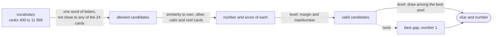

# 14. A clue-giver without a language model

Date: 2026-11-01 · Status: accepted

## Context

A bot that plays the Signaleur must give a signal (one word and a number, 1 to 4) from the grid as the Signaleur sees it: every card with its team, the revealed ones marked. It has no language model; it has the word vectors of [ADR 0009](0009-french-word-vectors-for-the-bots.md), where "close" is the cosine of two vectors.

A good signal is close to some words of the team and far from the others. A bad one costs: a word of the other team gives them a card, a calm word ends the turn, a reef ends the game. The bot has three levels, and a higher one must lead its guessers to more cards.

## Decision

**Candidates.** The words of ranks 400 to 11 999 of the vectors, which keeps out the function words and light verbs at the top of the frequency order and the names, typos and rare words at the bottom, and only those that are a signal for the server (letters, hyphens inside, 30 at most, once accents and ligatures are gone). A candidate is never close to any of the 24 cards, revealed or not, in the sense of the server's rule: equal, contained in or containing a word, or the same first four letters. That rule left `Room` for `SignalRule` so that the bot and the server cannot disagree: a clue the bot picks is a clue the server accepts. Revealed cards are excluded too, which the server does not require: a revealed word is still on the table and a clue that repeats it looks careless.

**The number and the score.** For a candidate, the similarity to each unrevealed card of the team gives the own words, best first. The danger is the largest similarity to an unrevealed card of the other team or a calm card, or to a reef plus 0.05 (a reef ends the game, so it counts as closer than it is). The number is how many own words, best first, are above the danger plus the level's margin, at most the level's `maxNumber` and the number of own words left; a candidate with none is not valid. The score is the sum, over those words, of their similarity minus the danger.

**The levels.** A level draws uniformly among its `pool` best valid candidates.

| | `maxNumber` | margin | pool |
|---|---|---|---|
| `EASY` | 2 | 0.00 | all the valid candidates |
| `NORMAL` | 3 | 0.02 | 5 |
| `HARD` | 4 | 0.03 | 1 |

Easy counts at most two words and takes any valid candidate, even one whose closest own word is barely ahead of a dangerous one. Hard takes the best candidate and the largest number it can defend. Normal is between.

**When nothing is valid** (the margin can be out of reach on a strange grid), the bot gives the candidate with the largest gap between its closest own word and the danger, for one word.

**Reproducible.** The clue-giver takes the random generator as a parameter and the scan is deterministic, so a fixed seed gives a fixed clue. Hard has a pool of one, so its seed does not change its clue.

## Measured

The guesser of [#52](https://github.com/Didelo-lilian/semaphore/issues/52) does not exist yet, and a guesser that reads the same vectors as the clue-giver would never miss: it would pick the cards by the very scores the clue-giver used. The test therefore blurs the reading with a Gaussian noise of 0.07 on each similarity, picks the cards from the closest, at most `number` of them, and counts the own cards found before the first mistake. 100 grids (8, 8, 6 and 2 cards of the word list, seeds 0 to 99) for Bâbord, the guesser's noise seeded too (`ClueGiverTest`, which asserts the order):

| | number given | own cards found | all the number found | stopped on a card of Tribord, a calm card, a reef |
|---|---|---|---|---|
| `EASY` | 1.19 | 0.73 | 57 | 21, 19, 3 |
| `NORMAL` | 2.13 | 1.94 | 83 | 8, 7, 2 |
| `HARD` | 2.23 | 2.10 | 87 | 6, 7, 0 |

These are the figures of one noise level, not of a player: they say that the levels are ordered and by how much. A clue takes about 30 ms (one scan of the candidates: 300 clues in 8 s, on a laptop, in a container).

The parameters were chosen with a numpy prototype of the same rule and the same noise; the figures above are the ones the Java test reproduces.

## Consequences

- The vocabulary is a web crawl's, so some candidates are proper nouns or odd words; the rank window keeps most of them out and the clue-giver filters only by rank and by the rule. A stoplist is possible if the games show a need.
- The clue-giver reads the same similarity as any guesser built on these vectors; the guesser of #52 gets its levels from the noise it adds and the point where it stops, not from other vectors.
- The clue-giver is a pure class with no room, socket or network, built once from the loaded vectors and immutable. Putting it in rooms is [#53](https://github.com/Didelo-lilian/semaphore/issues/53).
