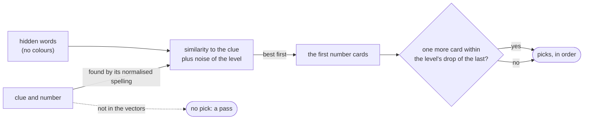

# 15. A guesser without a language model

Date: 2026-11-01 · Status: accepted

## Context

A bot that plays a lookout gets a signal (one word and a number) and picks cards from the grid, one at a time, until it has picked what it trusts or been wrong. It has no language model; it has the word vectors of [ADR 0009](0009-french-word-vectors-for-the-bots.md), as the clue-giver of [ADR 0014](0014-a-clue-giver-without-a-language-model.md) has. It must give three levels, and it must see only what a lookout sees: the words of the cards still hidden, never their colours.

## Decision

- **What it takes** is `List<String>`: the hidden words, the clue, the level and a random generator. The colour of a hidden card is not in the signature, so it cannot be used.
- **The reading** is the cosine of the clue and each hidden word, plus a Gaussian noise of the level's `noise` (a lookout does not read a word as sharply as a vector does, and a guesser on the clue-giver's own vectors would otherwise never miss). The cards are ordered by that reading, the closest first.
- **The picks** are the first `number` cards: the Signaleur vouches for the number, and a bot that stops short of it only gives up cards. The game lets a team pick one more (`number + 1`); the bot takes it only if that card reads within the level's `drop` of the last one, so it stops where its confidence drops.
- **The clue** is looked up by the spelling the server compares, so `ete`, `Été` and `été` are one word; of two words that collide, the more frequent one. A clue the vectors do not know gives nothing to go by: no pick, which the game calls a pass. The index is built when the guesser is (20 ms, 3.7 MiB of heap).
- **The levels** are those of `Level`, which now carries both roles:

| | `noise` | `drop` |
|---|---|---|
| `EASY` | 0.10 | 1.0, it always takes the extra card |
| `NORMAL` | 0.07 | 0.10 |
| `HARD` | 0.03 | 0.05 |

0.07 is the noise the clue-giver of ADR 0014 was measured with.

## Measured

`SelfPlay` (in the tests) plays a whole game by the rules of `Room`, with no room, socket or clock: 8, 8, 6 and 2 cards, two flags (a team that finds both reefs loses), up to `number + 1` picks, the game won by the team whose cards are all revealed. A team of a level, clue-giver and lookout, plays 200 games against a team of normal level, the starting team alternating (seeds 0 to 199). `SelfPlayTest` asserts the order:

| | wins against `NORMAL` |
|---|---|
| `EASY` | 3 % |
| `NORMAL` | 51.5 % (against itself) |
| `HARD` | 65 % |

The settings come from two rounds of the same kind of games, kept out of the code. Wins out of 200 against a normal team that never stops early and takes the extra card (103 for that team against itself):

| lookout rule of the normal team | wins |
|---|---|
| no extra card | 109 |
| stops at a gap between two picks of 0.05, 0.10, 0.20, even inside the number | 65, 70, 91 |
| picks the number, the extra card only within 0.02, 0.05, 0.10, 0.20 of the last | 110, 110, 108, 112 |
| stops 0.30 behind the best card | 103 |

and, in the first round, out of 150 games with a stop at 0.15 behind the best card, a noise of 0.00, 0.04, 0.07 (the reference) and 0.10 gave 86, 84, 80 and 60 wins; a tighter stop (0.10, 0.05) gave 59 and 39 against a reference at 0.15.

So **stopping inside the number costs games**, and the lookout trusts it. **Stopping before the extra card is worth little**: 108 to 112 against 103 and 109 is within the noise of 200 games (one standard deviation is about 7 games). It stays because it is what a careful lookout does and it costs nothing measurable, but the gap between the levels comes from the clue-giver and the noise, and the table above is the honest account of it. The easy team's 3 % is mostly its clue-giver (1.2 words a clue against 2.1 for normal, see ADR 0014): in the first round an easy clue-giver with the normal lookout's noise won 6 games of 150, and with the easy lookout's noise 4.

## Consequences

- A human Signaleur's clue outside the vectors (a name, a typo, a rare word) makes the bot pass, which costs the team its turn. Another rule (a random pick, the nearest known spelling) is possible in [#53](https://github.com/Didelo-lilian/semaphore/issues/53) if games show the need.
- The guesser is pure and immutable once built, like the clue-giver: a pick is at most 24 similarities of 200 dimensions. Its index adds 3.7 MiB to the 16 MiB of the vectors, against the 80 MiB of margin of ADR 0009.
- The same `Level` drives both roles of a bot, and a room can still give two bots two levels. A level is a pair of settings per role, in `Level`; changing one changes the table above, which `SelfPlayTest` checks.
- The self-play of the tests takes about 40 s on two CPUs. It is the only test of the level order; the others are quick.
