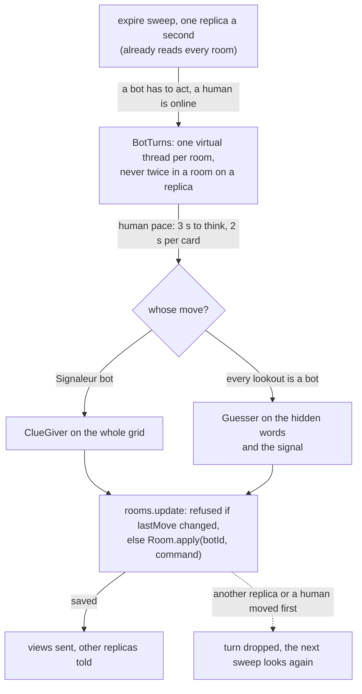

# 16. Bots take seats in a room

Date: 2026-11-01 · Status: accepted

## Context

The clue-giver ([ADR 0014](0014-a-clue-giver-without-a-language-model.md)) and the guesser ([ADR 0015](0015-a-guesser-without-a-language-model.md)) are pure classes. A room must let a human complete a team with bots, or play alone against them, without a second kind of room: the bot sits in a team in a role and plays through the same commands as a player ([ADR 0003](0003-rooms-the-state-machine-and-the-protocol.md)). The room is shared by replicas through a compare-and-set ([ADR 0008](0008-rooms-in-redis-shared-by-replicas.md)), a clue costs about 20 ms of one CPU, and the sweeps share three scheduler threads.

## Decision

- **A bot is a player.** `PlayerState` and `Player` get a `bot` (the name of its level, null for a human), added at the end of the record so a room saved before reads as all humans. It has an id and a token that nobody receives, no replica, no account. It counts as connected for ever: the start does not wait for it, no grace period or forfeit applies to it, and the sweep of dead replicas leaves it alone. A room is abandoned when no *human* is connected, as today, and a bot plays only while a human is connected, so a room of bots does not run on its own. When the last human leaves the lobby the bots go with them.
- **It is added and removed in the lobby, by the host** (`addBot(team, signaler, level)` and `removeBot(id)`, two commands allowed in the lobby only, two additive client messages). Seats are counted with the players (12). The Signaleur is still the first member of the team in the room's order ([ADR 0003](0003-rooms-the-state-machine-and-the-protocol.md)): a Signaleur bot goes to the front of that order, and is refused when the team's first member is already a bot; a lookout bot goes to the back, and is refused for a team with no member yet. The host is now the first *human*, since a Signaleur bot can be first. The view says who is, or will be, the Signaleur of a team from the lobby on, so what the host sees is what the start gives.
- **It plays on its own thread, never on the one that applies the moves.** The `expire` sweep, which takes its lock on one replica a second and reads every room anyway, hands `BotTurns` each room where `Room.botToAct()` finds a bot to wait for: the Signaleur of the team in play, or the first lookout when *all* its lookouts are bots (a human lookout plays, a bot beside them does not talk over them). `BotTurns` starts one virtual thread per room, at most one per room on a replica and at most 50 on a replica, so the sleeps cost nothing; two permits bound the clues computed at once. A bot waits 3 s before a signal and 2 s before each move of a guess (`semaphore.bots.think` and `semaphore.bots.pause`). It decides from the room as it read it before the wait, and the guard below refuses the move if the room changed meanwhile. Once a move is saved it goes on with the next bot turn of the room without waiting for the sweep.
- **A bot never moves twice.** Every move goes through `rooms.update`, which refuses it if the room's `lastMove` is no longer the one the bot decided on (`lastMove` changes with every accepted command or pass and not with a spectator or a connection, which a version would: a bot would lose its turn whenever someone came to watch). It is an instant, and two moves of a room are a round trip to the store apart, far more than the clock's resolution; `BotTurnsTest` advances its clock between the two moves for that reason. A second replica that saw the same turn, a human who passed first, a sweep that passed the turn: the loser finds the room moved on, throws away its decision and the next sweep looks again. A replica that dies in the middle of a turn leaves the room as the last move saved it: any replica's next sweep finds the bot due, and the new thread plays the rest of the turn from the room: it counts on `revealsLeft - 1` cards and picks again among the words still hidden.
- **It sees what its role sees.** The Signaleur bot gets the whole grid with the colours, like a Signaleur. The lookout bot gets `List<String>`, the words still hidden, and the signal: the colours are not in what it is given.
- **A bot is a participant of the game without an account.** A game with a signed-in human is recorded as before ([ADR 0012](0012-finished-games-profiles-and-the-leaderboard.md)), its bots as participants with no account, like a guest, which the history cannot tell from a guest (a `bot` column would, when a profile needs it); a game with no account, bots or not, is not kept.
- **A rolling deploy.** `bot` is an additive field, null for a human, and the messages are additive. An older replica that saves a room with a bot in it drops the field (it knows no `bot`), and the bot becomes a player that nobody plays for, which the usual graces pass; that needs a bot added during the minutes of a deploy. The front reads a player with no `bot` as a person, so it can be deployed before the backend: its controls then get the older backend's "unreadable message".
- **The front** shows a bot with its level and, in the lobby, the Signaleur of each team. The host picks a level once, adds a bot to a team as Signaleur or as lookout (what the room would refuse is greyed out) and takes one off with "Retirer". The people online do not count the bots.

## Consequences

- No new shared state: the pace is in the thread of a replica, the order in the saved room, the exactly-once in the compare-and-set. A bot turn costs one read per sweep for every room and a thread for a room with a bot waiting.
- The turn of a bot is as late as the sweep (up to a second) plus its pace, and a bot waits for a human to be online: a table of one human who left is paused, then dropped after 30 minutes like any room.
- A human Signaleur's clue that the guesser does not know (a name, a typo) makes the bot lookout pass ([ADR 0015](0015-a-guesser-without-a-language-model.md)).
- The saved room and the view grow by a short field a player, `null` for a person; a room with bots is no heavier than a room of as many people.
- A bot can be told from a person in the room, not in the history; a game of one person against bots is kept like any game of a signed-in player, with the bots as opponents without an account.
